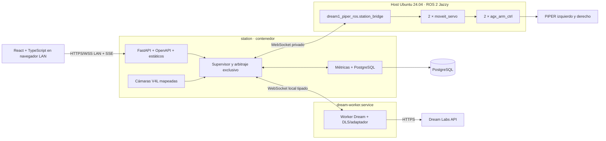

# Operación de la aplicación Piper + Dream-1

Esta guía describe el scaffold operativo de la aplicación Piper + Dream-1 en
`dream1-piper`: API FastAPI, UI TypeScript, servicio worker, persistencia y
bringup ROS 2 Jazzy. Distingue lo que ya está escrito y verificado en software
de lo que aún requiere instalar el driver ROS y probarlo con los brazos reales.

## Estado actual y brechas

El experimento funcional está en `experiments/piper_station_worker/`:

- `station` es dueño de CAN, cámaras, supervisor, validación y streamers Piper.
- `worker` obtiene observaciones por WebSocket, llama a Dream, resuelve el DLS
  local y devuelve acciones articulares para validación de la estación.
- La consola temporal es HTML/JavaScript servido por FastAPI dentro de la
  estación. Usa `GET /api/status`, JPEG de cámaras y `POST` para validar, armar,
  iniciar, pausar, Home y resetear fallos.
- El worker usa modo `action` de forma predeterminada. La estación aún requiere
  `Validate → Arm → Start` antes de aceptar acciones.
- Los dispositivos Piper actuales se abren con `piper_sdk`; el perfil tiene
  left → `can0`, right → `can1`, y cámaras `/dev/v4l/by-path`.

El estado de implementación del repo es:

| Requisito | Estado actual | Límite de verificación |
| --- | --- | --- |
| Acceso LAN | FastAPI sirve UI/API con sesión de operador y TLS configurable | Certificados, firewall y acceso desde otra máquina dependen del despliegue |
| Frontend | React + TypeScript 7, Tailwind 4, componentes accesibles y build Bun | Build local verificado; no hay browser E2E contra hardware |
| API | FastAPI, OpenAPI y Scalar en `/api-docs` | Endpoints cubiertos parcialmente con tests unitarios, no desde hardware |
| ROS 2 Jazzy | Driver AgileX, dos instancias MoveIt Servo y `station_bridge` definidos en `ros2_ws` | `colcon build` del workspace validado; no se ha ejecutado movimiento físico desde la aplicación |
| Control desde UI | Selector Dream/teleop, cámara, tarea, validación, Arm/Start/Pause/Home y jog con deadman | Teleop requiere bridge ROS y feedback real; Dream requiere credenciales válidas |
| Métricas | Eventos y latencias en memoria o persistidas con cola asíncrona a PostgreSQL | PostgreSQL es opcional en desarrollo; memoria se pierde al reiniciar station |
| Servicios | Contenedores `station` y `worker`; PostgreSQL es infraestructura. ROS launch vive en host Jazzy | No ejecutar perfil legado `piper_sdk` a la vez que los nodos ROS en los mismos CAN |

La arquitectura de referencia recuperada está versionada en
[`.references/Tareas-con-Piper-Referencias.md`](../.references/Tareas-con-Piper-Referencias.md).
El material incluye recomendaciones de sincronización temporal, observaciones,
acciones EEF, límites y registro; no contiene la presentación de teleoperación.

## Arquitectura objetivo

Se mantienen dos servicios de aplicación desplegables: estación y worker. La
persistencia puede añadir PostgreSQL como servicio de infraestructura de Docker
Compose, no como un tercer backend de aplicación. FastAPI,
el build web, supervisión de movimiento, adquisición de cámaras, métricas y
nodos ROS 2 son módulos del servicio de estación.



La estación es la única autoridad que puede solicitar movimiento físico. El
navegador nunca abre CAN/V4L ni publica directamente en ROS. El worker tampoco
abre CAN: entrega propuestas Dream por el protocolo estación-worker existente,
con versión de esquema, sesión, generación y secuencia. La estación rechaza
propuestas viejas, fuera de límites o recibidas en un estado no ejecutable.

`station` inicia API, frontend, cámaras, arbitraje y métricas. `worker` ejecuta
Dream y se conecta por WebSocket TLS interno a `station`. En el host, el launch
ROS 2 inicia dos nodos `agx_arm_ctrl` (uno por brazo), dos nodos
`moveit_servo/servo_node_main` y el nodo propio `dream1_piper_ros/station_bridge`.
Ese bridge expone el WebSocket local que consume la estación. La UI se publica
a la LAN; ROS DDS y CAN permanecen en el host de control.

### ROS 2 Jazzy y movimiento

El despliegue usa Ubuntu 24.04 con ROS 2 Jazzy, el driver ROS 2
oficial de AgileX para Piper y la configuración MoveIt 2 del brazo. Para dos
brazos se configuran instancias/namespaces independientes (`left`, `right`) y
CAN por configuración; el mapeo actual es left → `can0`, right → `can1`, pero
debe confirmarse contra el rig durante el preflight de la máquina.

MoveIt Servo recibe velocidades cartesianas del efector final y produce comandos
articulares limitados. La configuración de estación debe activar comprobación
de colisiones, límites articulares y de velocidad, manejo de singularidad y
suavizado. La estación mantiene su propio deadman/watchdog y gate de control:
una protección de software no equivale a un E-stop ni a un safety PLC. No habrá
publicador alternativo ni uso simultáneo del Piper SDK directo una vez migrado
el control a ROS.

Fuentes técnicas: [driver ROS 2 oficial AgileX](https://github.com/agilexrobotics/agx_arm_ros/blob/ros2/README_EN.md),
[configuración MoveIt de AgileX](https://github.com/agilexrobotics/agx_arm_ros/blob/ros2/src/agx_arm_moveit/README_EN.md)
y [MoveIt Servo](https://moveit.picknik.ai/main/doc/examples/realtime_servo/realtime_servo_tutorial.html).
MoveIt Servo admite comandos EEF cartesianos, límites articulares/velocidad y
comprobaciones de colisión y singularidad; estas funciones deben configurarse
y verificarse para el URDF/SRDF concreto del Piper antes de habilitar movimiento.

## Despliegue y configuración

### Perfil existente (no ROS)

Para reproducir el experimento actual:

```bash
.venv/bin/python -m pip install -r requirements-dream-test.txt
cp .env.example .env
.venv/bin/python -m experiments.piper_station_worker.preflight --check-devices
.venv/bin/python -m experiments.piper_station_worker.station
```

En otra terminal:

```bash
.venv/bin/python -m experiments.piper_station_worker.worker
```

Abre `http://127.0.0.1:8080`; el puerto `8765` es WebSocket, no una página web.
Esta secuencia sólo documenta el estado actual, que sigue utilizando el SDK
Piper directamente y no ofrece teleoperación LAN.

El perfil actual carga `experiments/piper_station_worker/config/robot.yaml` para
esquema 14D, límites, CAN, cámaras, sincronía y streamer; `config/dream.yaml`
contiene checkpoint, tarea, roles de cámara, frecuencias, horizonte y DLS.
`RSTACK_DREAM_MODE=action` es el default; `observe` impide enviar acciones desde
worker, pero no corta torque ni desconecta CAN. Los valores exportados por el
proceso prevalecen sobre `.env`, y `.env` sobre YAML. El perfil configura left →
`can0`, right → `can1`, cámaras `left/top/right` en `/dev/v4l/by-path`, 640×360,
30 FPS; la estación produce observaciones a 20 Hz y exige skew de cámara máximo
60 ms con espera de sincronización de hasta 100 ms. El orden de cámaras sigue
`Robotics_train_stack/configs/robots/piper_bimanual_dream1.yaml`: USB-1 → `left`
(muñeca izquierda, MJPG 640×480), USB-3 → `top` (ZED estéreo, YUYV 1344×376,
recorte del ojo izquierdo), USB-2 → `right` (muñeca derecha, MJPG 640×480).
La UI muestra esos nombres como Muñeca izquierda, Cenital y Muñeca derecha.
Home usa esa misma postura baja de referencia; su altura TCP nominal por FK es
~0,125 m frente a ~0,470 m de la postura anterior. Confirmar despeje del área
antes de ejecutar Home con los brazos físicos.

Rutas reales de la consola temporal (no son las rutas objetivo `/api/v1`):

| Método y ruta actual | Uso |
| --- | --- |
| `GET /` | HTML/JavaScript desde `web/index.html`. |
| `GET /api/status` | Estado, cámaras, worker, contadores y resumen de métricas. |
| `GET /api/cameras/{name}.jpg` | Último JPEG capturado. |
| `POST /api/validate`, `/api/task`, `/api/arm`, `/api/start`, `/api/pause`, `/api/home`, `/api/reset-fault` | Validar, editar tarea, controlar ciclo, Home y reset supervisado. |

Los errores de transición actuales usan HTTP 409 y `detail`. La secuencia es
`READY/PAUSED → Validate → Arm → ARMED → Start → RUNNING`; Pause vuelve a
`PAUSED`. Watchdog, fallo de cámara o desconexión hacen pausa y descartan cola;
un error al enviar/mantener puede terminar en `FAULT`. Pause intenta mantener
posición y no corta torque. Home pausa primero y ejecuta el objetivo de perfil;
debe usarse sólo con el área despejada. Reset no llama a `ResetPiper`: si hay
fallo del controlador, sostener el brazo y realizar recuperación física antes
de resetear y volver a validar.

### Workspace ROS 2 Jazzy

El workspace de ROS está implementado en `ros2_ws/`. `station.launch.py` crea
dos instancias del driver `agx_arm_ctrl` bajo namespaces `left` y `right`, un
nodo `moveit_servo/servo_node` por brazo y el nodo propio
`dream1_piper_ros/station_bridge`. El driver físico usa `pyAgxArm` y CAN;
`ros2_control` también crea un `GenericSystem` ficticio para la integración de
MoveIt, así que su presencia en los logs no confirma conexión física. El bridge combina feedback, convierte
velocidades teleop a `TwistStamped`, permite acciones Dream cuando los gates
están abiertos y ofrece el endpoint loopback que consume la API. Las rutas CAN
y `speed_percent` llegan como variables de entorno del launch; URDF/SRDF y
parámetros Servo permanecen en archivos de configuración. El tópico de estado
de ese `GenericSystem` se mantiene separado de `control/joint_states`, que es
el tópico de comandos del driver físico.

Antes de usar ROS, instala `pyAgxArm` para el Python de sistema 3.12 y detén
cualquier perfil legado `piper_sdk` que abra los mismos CAN. No ejecutar
`ResetPiper` automáticamente. Los nodos instalados del driver usan
`/usr/bin/python3`; un Conda activo puede hacer que scripts con
`/usr/bin/env python3` intenten cargar bindings ROS 3.12 con Python 3.13. Lanza
ROS con `/usr/bin` primero en `PATH`, y confirma `python3 --version` como 3.12.

### Docker Compose y variables de entorno

`compose.yaml` define `station` y `worker`; PostgreSQL es opcional y se activa
con el perfil Compose `database`. En el modo temporal `memory` sólo corren los
dos servicios de aplicación y no se descarga la imagen de Postgres. ROS 2 Jazzy se instala y
ejecuta en el host Ubuntu para que DDS, CAN y los controladores Piper no queden
dentro de una imagen Python que no incluye ROS. La estación se conecta al nodo
`station_bridge` del host por `127.0.0.1:8766`. Compose asigna dispositivos V4L
sólo al contenedor `station`; `worker` no recibe acceso a CAN ni cámaras. Los
servicios station/worker usan `network_mode: host` porque el bridge ROS escucha
en loopback y worker usa WebSocket al loopback de station. En el perfil local
la UI usa HTTP sólo en `127.0.0.1`, sin TLS; cuando se activa, PostgreSQL
permanece aislado en bridge y publica su puerto sólo en `127.0.0.1`. No se usa `privileged`; el
firewall del host debe limitar el puerto UI a la LAN de operación.

YAML conserva el perfil de hardware en `configs/app_robot.yaml` y la
configuración de Dream en `experiments/piper_station_worker/config/dream.yaml`.
Esos archivos son la fuente de configuración funcional (límites, buses, cámaras,
frecuencias y modelo/tarea por defecto). `.env` contiene la clave DreamLabs y
overrides específicos del host; para desarrollo local admite tokens dummy y no
requiere certificados. Compose lee `.env` para interpolar dispositivos,
PostgreSQL (si se activa) y puertos, y lo inyecta en `station` y `worker` con `env_file: .env`.
Los overrides de dispositivos del contenedor se aplican en Compose; la API y el
worker aplican sus variables `RSTACK_*` por encima del YAML al iniciar. Así el
YAML sigue siendo editable y portable, mientras `.env` adapta la misma
configuración al host sin duplicar el perfil en otro YAML.

Inicialización en una máquina nueva:

```bash
cp .env.example .env
chmod 600 .env
```

Para funcionamiento local elige `RSTACK_STORAGE_BACKEND=memory` en `.env` si
PostgreSQL aún no está instalado/disponible. Usa tokens dummy, conserva una clave
real en `DREAM_API_KEY` y configura `CAMERA_*_HOST` con los enlaces
`/dev/v4l/by-path` del host. No se requieren credenciales de Postgres ni valores
TLS en este modo; tareas e historial se pierden al reiniciar `station`.

Con `RSTACK_STORAGE_BACKEND=postgres`, conserva el DSN local en `DATABASE_URL`,
alinea `POSTGRES_PASSWORD` y arranca el perfil `database`. `DATABASE_URL` usa
`127.0.0.1` porque station comparte la red del host.

Para desplegar en LAN, usa `compose.production.yaml`, tokens fuertes y TLS:
certificado con SAN para la IP/nombre del host y `127.0.0.1`; `TLS_CA_HOST` debe
apuntar a la CA que firma el certificado del servidor.

Si `pyAgxArm` no está instalado para Python 3.12, instálalo antes de lanzar
(el repositorio AgileX documenta este SDK por separado):

```bash
sudo apt install -y python3-pip
tmpdir="$(mktemp -d)"
git clone --depth 1 https://github.com/agilexrobotics/pyAgxArm.git "$tmpdir/pyAgxArm"
/usr/bin/python3 -m pip install --user --break-system-packages "$tmpdir/pyAgxArm"
rm -rf "$tmpdir"
```

No uses `pip` sin `/usr/bin/python3`: el `pip` de Conda instala el SDK en
Python 3.13, que los nodos del driver no cargan. El bridge admite tanto
`websockets` 10.x (paquete de Ubuntu/Jazzy) como las versiones recientes.

Primero compila e inicia ROS 2 Jazzy en el host:

Mantén una sola instancia de `station.launch.py`: el launch verifica que
`127.0.0.1:8766` esté libre antes de crear los drivers, y rechaza un segundo
arranque para evitar duplicar nodos y gateways.

```bash
cd ~/NONHUMAN/dream1-piper
conda deactivate 2>/dev/null || true
export PATH="/usr/bin:/bin:/usr/sbin:/sbin:$PATH"
unset PYTHONHOME PYTHONPATH
python3 --version  # debe mostrar Python 3.12.x
set -a
. ./.env
set +a
source /opt/ros/jazzy/setup.bash
cd ros2_ws
source install/setup.bash
cd ..
python3 -c 'import pyAgxArm; print("pyAgxArm:", pyAgxArm.__file__)'
cd ros2_ws
colcon build --symlink-install --packages-select dream1_piper_ros
source install/setup.bash
ros2 launch dream1_piper_ros station.launch.py
```

Detén antes cualquier proceso legado que abra `can0`/`can1` con `piper_sdk`.
En modo temporal sin PostgreSQL, agrega o actualiza
`RSTACK_STORAGE_BACKEND=memory` en `.env` (si el archivo se creó antes de esta
opción, la variable todavía no existe). Desde la raíz del repo:

```bash
if grep -q '^RSTACK_STORAGE_BACKEND=' .env; then
  sed -i 's/^RSTACK_STORAGE_BACKEND=.*/RSTACK_STORAGE_BACKEND=memory/' .env
else
  printf '\nRSTACK_STORAGE_BACKEND=memory\n' >> .env
fi
sudo docker compose --env-file .env up -d --build station worker
docker compose ps
docker compose logs -f station worker
```

En modo PostgreSQL establece `RSTACK_STORAGE_BACKEND=postgres` y levanta
`sudo docker compose --env-file .env --profile database up -d --build postgres station worker`.
El entrypoint espera PostgreSQL y aplica `alembic upgrade head` antes de FastAPI;
en memoria omite conexión y migraciones. En local abre
`http://127.0.0.1:${RSTACK_UI_PORT}`. El worker espera el healthcheck y conecta por WS a `127.0.0.1`.
Para LAN, agrega `-f compose.production.yaml --profile database` a los comandos
de Compose; ese perfil usa HTTPS/WSS y requiere TLS. El modo worker predeterminado es `action`; cambia
`RSTACK_DREAM_MODE=observe` en `.env` para observar sin ejecutar objetivos.
Ambos modos mantienen el procedimiento `Validate → Arm → Start`. Scalar queda
en `/api-docs`; OpenAPI nativo de FastAPI, en `/openapi.json`.

Para parar limpiamente usa `docker compose down`. El modo memoria pierde todo
el estado al parar/recrear `station`; Postgres conserva datos en su volumen.
No uses `-v` salvo que se quiera borrar PostgreSQL. La cámara, ROS y estado físico se
verifican en `/readyz` y en la UI; un build de contenedores no valida movimiento
real. Compose espera que la estación esté healthy antes del worker; el entrypoint
espera Postgres sólo en el modo persistente.

Comandos de operación:

```bash
docker compose --env-file .env config -q
docker compose build station worker
docker compose --env-file .env --profile database up -d postgres station worker
docker compose ps
docker compose logs -f station worker
```

Parar sin borrar persistencia:

```bash
docker compose down
```

No usar `docker compose down -v` en operación normal porque borra PostgreSQL.
Reiniciar con `docker compose restart station` o `docker compose restart worker`.
Backup en formato custom:

```bash
mkdir -p backups
docker compose exec -T postgres sh -c 'pg_dump -U "$POSTGRES_USER" -d "$POSTGRES_DB" -Fc' > backups/dream1-piper.dump
```

La restauración reemplaza datos; pausar control, conservar una copia del volumen
y restaurar en una instancia de mantenimiento:

```bash
cat backups/dream1-piper.dump | docker compose exec -T postgres sh -c 'pg_restore --clean --if-exists -U "$POSTGRES_USER" -d "$POSTGRES_DB"'
```

Definir ubicación externa del backup, retención y prueba periódica de restore.
Si la DB cae, la UI muestra degradación; el loop de movimiento no espera
bloqueado por la base: encola escritura acotada y muestra pérdidas/saturación
de métricas.

### Variables y configuración

Los YAML describen perfil del robot, límites, cámaras y parámetros del worker;
`.env` contiene secretos y valores de despliegue por máquina. Las variables
exportadas por `systemd` prevalecen sobre `.env`, que prevalece sobre YAML y
defaults validados. Los valores reales de límites, CAN, cámaras y frame ids no
se duplican en TypeScript.

| Variable | Default / propósito |
| --- | --- |
| `RSTACK_DREAM_MODE` | `action`; `observe` sólo para inferencia de lectura. La estación siempre exige Validate → Arm → Start. |
| `RSTACK_DREAM_MODEL` | Override opcional del checkpoint de Dream YAML. |
| `RSTACK_DREAM_TASK` | Override opcional de la tarea inicial; editable sólo en `READY`/`PAUSED`. |
| `RSTACK_DREAM_STATION_URL` | `ws://127.0.0.1:8443/api/v1/worker` local; WSS en perfil production. |
| `RSTACK_DREAM_METRICS_WINDOW` | `200`; ventana actual en memoria. |
| `RSTACK_UI_HOST` / `RSTACK_UI_PORT` | Bind FastAPI. Local: `127.0.0.1:8443`; LAN: `0.0.0.0`. |

| `RSTACK_UI_OPERATOR_TOKEN` | Token obligatorio para comandos de control y teleoperación en el perfil LAN; secreto sólo en `.env`/secret store. |
| `RSTACK_UI_TLS_CERT` / `RSTACK_UI_TLS_KEY` | Certificado y clave para HTTPS/WSS desde la LAN; rutas locales con permisos restringidos. |

| `RSTACK_STORAGE_BACKEND` | `postgres` por defecto; `memory` evita conexión/migraciones y conserva tareas e historial sólo hasta reiniciar station. No permitido en production. |
| `RSTACK_MEMORY_HISTORY_LIMIT` | `100000`; máximo configurable (tope 100000) de muestras por colección de memoria, EventBus y acumulador de métricas; al llenarse, descarta las más antiguas. |
| `RSTACK_METRICS_QUEUE_SIZE` | `10000`; capacidad de la cola asíncrona de escritura, separada del límite de retención de 100000 muestras. |
| `RSTACK_EVENTS_HEARTBEAT_SECONDS` | `15`; intervalo de keepalive SSE para mantener visible la conexión de actividad cuando no hay eventos. |
| `RSTACK_EVENTS_FALLBACK_POLL_MS` | `2000`; intervalo del sondeo de historial que mantiene Actividad actualizada mientras SSE se reconecta (rango 250–60000 ms). |
| `DATABASE_URL` | DSN PostgreSQL para la estación; sólo se usa con backend `postgres`; en Compose usa `127.0.0.1:${POSTGRES_PORT}` por red host. |
| `POSTGRES_DB`, `POSTGRES_USER`, `POSTGRES_PASSWORD` | Credenciales de inicialización PostgreSQL; sólo se requieren para activar el perfil `database`. |
| `POSTGRES_PORT`, `POSTGRES_IMAGE` | Puerto de host sólo en `127.0.0.1`; imagen con major compatible y digest probado en release. |
| `CAMERA_LEFT_HOST`, `CAMERA_TOP_HOST`, `CAMERA_RIGHT_HOST` | Rutas persistentes del host mapeadas a los dispositivos del contenedor estación. |
| `RSTACK_CAMERA_LEFT_DEVICE`, `RSTACK_CAMERA_TOP_DEVICE`, `RSTACK_CAMERA_RIGHT_DEVICE` | Rutas internas de cámara dentro del contenedor estación. |
| `VIDEO_GID` | GID del grupo host con acceso V4L. |
| `TLS_CERT_HOST`, `TLS_KEY_HOST`, `TLS_CA_HOST` | Certificados del host montados sólo con `compose.production.yaml`; no usados localmente. |
| `RSTACK_ROS_BRIDGE_URL` | `ws://127.0.0.1:8766`; endpoint privado del nodo bridge ROS en el host. |
| `RSTACK_CAN_LEFT`, `RSTACK_CAN_RIGHT` | Interfaces CAN; el launch ROS admite estos overrides. |
| `RSTACK_ROBOT_SPEED_PERCENT` | Velocidad inicial del driver ROS, configurable en `.env`. |
| `RSTACK_HOME_DURATION_S`, `RSTACK_HOME_TOLERANCE_RAD` | Tiempo y tolerancia de llegada para Home supervisado por feedback. |
| `RSTACK_POSE_METRICS_HZ`, `RSTACK_POSE_METRICS_MAX_TARGET_AGE_MS` | Frecuencia máxima por brazo (default 1/3 Hz, cada 3 s) y ventana temporal máxima para emparejar feedback TCP con su objetivo. |
| `RSTACK_METRICS_RETENTION_DAYS` | Retención detallada en configuración; limpieza automática aún pendiente. |
| `ROS_DOMAIN_ID` | Dominio ROS local; mantener DDS dentro del host/red de control configurada. |
| `ROS_AUTOMATIC_DISCOVERY_RANGE` | `LOCALHOST`; ROS sólo descubre nodos en el mismo host. |

`RSTACK_DREAM_MODE` y `control_source` representan conceptos distintos:
`RSTACK_DREAM_MODE=action|observe` configura si el worker puede emitir acciones
Dream (default `action`); `control_source=dream|teleop` indica quién tiene el
control de la operación. `observe` bloquea acciones del worker, pero no
convierte el sistema en modo manual ni desconecta/libera los motores. La UI
presenta ambos valores y la estación rechaza control Dream si el worker está en
`observe`.

No incluir claves, token ni credenciales reales en Git, frontend, URLs o logs.
Si el token falta, la app LAN debe rechazar acciones y teleoperación (fail
closed); no debe caer silenciosamente a acceso abierto. El control remoto usa
HTTPS/WSS directamente en la estación con certificado configurado; no se admite
enviar el bearer token por HTTP claro. Estado y cámaras pueden ser de sólo
lectura para clientes sin token según la política de red del host.

## Contratos de la aplicación

### API estación-frontend

FastAPI es el contrato público de UI y sirve el bundle React desde el mismo
origen. FastAPI genera y publica el único contrato HTTP OpenAPI en
`GET /openapi.json`; Scalar lo renderiza en `/api-docs` tanto en desarrollo como
en producción. Desactivar Swagger UI y ReDoc (`docs_url=None`, `redoc_url=None`)
para no ofrecer documentadores duplicados. Scalar lee `app.openapi_url`; no se
mantiene otra copia YAML/JSON del esquema. Frontend/codegen consumen el mismo
`/openapi.json`. En desarrollo, Vite proxifica API, SSE, WebSocket, Scalar y
OpenAPI a FastAPI; en despliegue, FastAPI sirve el build estático y las mismas
rutas de documentación. No abrir CORS amplio.

El backend declara `scalar-fastapi` en `pyproject.toml` y lo bloquea en
`uv.lock`. `add_scalar_reference(app, route="/api-docs")` instala la referencia
interactiva desde el documento OpenAPI nativo de FastAPI. Los requests que Scalar
permite probar siguen protegidos por el mismo token/sesión y las mismas
validaciones de la estación; no crear credenciales alternas para la
documentación. La documentación oficial de [FastAPI + Scalar](https://scalar.com/docs-for/fastapi)
describe esta integración y el uso del esquema generado por FastAPI.

Configuración requerida de la app factory:

```python
from fastapi import FastAPI
from scalar_fastapi import add_scalar_reference

app = FastAPI(
    title="dream1-piper station API",
    openapi_url="/openapi.json",
    docs_url=None,
    redoc_url=None,
)
add_scalar_reference(app, route="/api-docs")
```

La configuración real toma título/versión desde `pyproject.toml` o settings
validados, y añade servers/auth/versiones mediante modelos de FastAPI; no editar
el resultado de `app.openapi()` a mano.

### Stack y estructura del proyecto

El monorepo ya contiene el scaffold de aplicación en `backend/`, `frontend/`,
`ros2_ws/`, `docker/` y `compose.yaml`. Versiones estables fijadas al
27-11-2026: FastAPI `0.163.1`, `uv` `0.13.10`, Bun `1.4.5` y TypeScript
`7.0.2` ([FastAPI](https://fastapi.tiangolo.com/release-notes/),
[uv](https://github.com/astral-sh/uv/releases), [Bun](https://bun.sh/blog/release-notes/bun-v1.4.5),
[TypeScript](https://github.com/microsoft/TypeScript/releases)). Al comenzar el
scaffold se vuelve a comprobar la última estable en sus fuentes oficiales; no
se usa `latest`, canary ni versiones flotantes en imágenes o instalaciones
reproducibles. Registrar toolchains en `mise.toml`, Python
`3.12.x` para compatibilidad binaria con ROS 2 Jazzy, las dependencias Python en
`pyproject.toml`/`uv.lock`, y JS en `package.json`/`bun.lock`.

Contenido esperado de `mise.toml` en el scaffold:

```toml
[tools]
python = "3.12"
uv = "0.13.10"
bun = "1.4.5"
```

```text
backend/
  pyproject.toml
  uv.lock
  src/dream1_piper/
    main.py                 # fastapi CLI entrypoint/app factory
    api/v1/                 # routers, dependencies, request/response schemas
    core/                   # settings, lifespan, logging, errors
    domain/                 # states, entities, ports, invariants
    services/               # use cases: operations, teleop, metrics
    adapters/
      postgres/             # SQLAlchemy async, repositories, unit of work
      ros/                  # ROS 2/MoveIt Servo bridge, no HTTP concerns
      station_worker/       # versioned WebSocket protocol
      cameras/              # camera adapter and frame health
    worker/                 # Dream policy, inference, DLS, queue, CLI
  migrations/               # Alembic revisions
  tests/                    # unit, API and hardware-free integration
frontend/
  package.json
  bun.lock
  tsconfig.json
  vite.config.ts
  src/
    app/                    # routing, providers, auth/session shell
    features/
      operation/            # state machine view, task, arm, pause/home
      teleop/               # gamepad, deadman, selected-arm controls
      dream/                # task prompt and worker status
      metrics/              # live/historical charts and filters
    components/ui/          # shadcn/ui components
    lib/api/                # generated OpenAPI client and typed calls
    lib/realtime/           # SSE/WebSocket clients and reconnect policies
ros2_ws/src/                # Jazzy bringup, MoveIt config and launch files
tools/openapi-codegen/      # generación OpenAPI aislada con TS API compatible
compose.yaml
docker/
  station.Dockerfile
  worker.Dockerfile
```

Backend routes sólo validan transporte/autorización y delegan casos de uso;
casos de uso dependen de contratos de dominio, no de FastAPI ni del ORM. Los
repositorios implementan puertos de dominio; los adaptadores ROS son el único
camino desde supervisor a comandos. `main.py` crea la app y su `lifespan` abre y
cierra pool PostgreSQL, escritor de métricas, estación ROS y recursos, sin
conectar hardware al importar módulos. Cada endpoint declara response model,
códigos de error y autenticación; cada WebSocket valida tamaño, frecuencia,
secuencia, autorización y forma de mensaje.

`mise.toml` fija las versiones vigentes de `uv`, Bun y Python para desarrollo y
CI. El backend declara FastAPI y sus dependencias runtime en `project.dependencies`
y lint/typecheck/test en grupos de desarrollo; `uv.lock` se versiona. En el
scaffold, declarar `fastapi[standard]>=0.163.1,<0.164.0` en `pyproject.toml` y
cometer la resolución exacta en `uv.lock`; el lock, no un rango abierto, define
lo instalado. Usar
`uv sync --locked` en CI y Docker, `uv run` para ejecutar, Alembic para migrar y
no mantener un segundo inventario de dependencias en `requirements.txt` para la
app. La documentación oficial de uv explica el proyecto/lock/sync reproducible
([proyectos](https://docs.astral.sh/uv/guides/projects/),
[lock](https://docs.astral.sh/uv/concepts/projects/sync/)).

En frontend, `package.json` fija `packageManager: "bun@1.4.5"`; `bun.lock` es
texto y se versiona; TypeScript se fija exactamente en `"typescript": "7.0.2"`.
Usar `bun install --frozen-lockfile`/`bun ci` en CI y Docker, scripts declarados
en `package.json`, TypeScript `strict` con
`noUncheckedIndexedAccess` y `exactOptionalPropertyTypes`, y validación runtime
de mensajes de red. La documentación Bun requiere lockfile comprometido para
instalación congelada ([lockfile](https://bun.sh/docs/pm/lockfile),
[instalación reproducible](https://bun.sh/docs/pm/cli/install)).

TypeScript `7.0.2` es el compilador estable a usar para `typecheck` y build. Su
versión actual no ofrece API de compilador; verificar compatibilidad de cada
generador/linter. Si una herramienta necesita esa API, aislarla con
`@typescript/typescript6` como compatibilidad exclusiva de tooling y no reemplazar
el typecheck TS 7 de la aplicación. La guía de migración oficial explica el
modo dual 6/7 y el estado de la API
([TypeScript 7](https://devblogs.microsoft.com/typescript/announcing-typescript-7-0/)).
La generación OpenAPI se aísla en `tools/openapi-codegen/` con Bun `1.4.5`,
`openapi-typescript` `7.13.0` y TypeScript `5.9.3`, con su propio
`package.json`/`bun.lock`; así cumple el peer dependency y no comparte API de
compilador con TypeScript 7 de la aplicación. `openapi-fetch` y los tipos `.d.ts`
generados se consumen desde frontend TypeScript 7. El generador lee
`/openapi.json` y CI regenera/verifica que no haya diff. No editar a mano los
archivos generados. Esta separación sigue la compatibilidad reportada por
[openapi-typescript](https://github.com/openapi-ts/openapi-typescript/issues/2841).

Comandos de desarrollo objetivo:

```bash
cd backend && uv sync --locked
cd backend && uv run fastapi dev src/dream1_piper/main.py
cd frontend && bun install --frozen-lockfile
cd frontend && bun run dev
```

En producción, la etapa de build de estación compila frontend con Bun y backend
con `uv sync --locked --no-dev`; copia el `dist/` resultante al runtime FastAPI.
El worker instala sólo dependencias de su grupo con uv y no contiene Bun ni
assets web. Runtime no actualiza dependencias al arrancar. Ejecutar migraciones
antes de readiness, procesos como usuario no-root, usar imagen base ROS Jazzy
compatible, y publicar imágenes con tags inmutables/digest.

Los Dockerfiles de app usan etapas reproducibles, por ejemplo builder
`oven/bun:1.4.5` para `bun ci && bun run build`, uv binario desde
`ghcr.io/astral-sh/uv:0.13.10` y runtime ROS Jazzy con Python 3.12; fijar digest
de las tres imágenes en releases. Station arranca con
`uv run --locked fastapi run src/dream1_piper/main.py`; worker con el entrypoint
declarado en `[project.scripts]` y el mismo `uv.lock`. La imagen de worker no
necesita incluir FastAPI CLI si su grupo de dependencias no la requiere.

| Ruta objetivo | Uso |
| --- | --- |
| `GET /healthz`, `GET /readyz` | Liveness y readiness de storage/ROS/cámaras; `/readyz.storage` informa backend y persistencia. Worker se informa por separado para evitar ciclo de arranque. |
| `GET /openapi.json` | Esquema OpenAPI generado por FastAPI, fuente para Scalar y codegen TypeScript. |
| `GET /api-docs` | Scalar API Reference en dev y producción; reemplaza Swagger/ReDoc. |
| `POST /api/v1/auth/session`, `DELETE /api/v1/auth/session` | Intercambia token operador por sesión web segura y revoca la sesión. |
| `GET /api/v1/status` | Estado, bloqueos, brazos, feedback, cámaras, worker, tarea y salud. |
| `GET /api/v1/cameras/{name}.jpg` | Último JPEG de `left`, `top` o `right`; no crea una segunda adquisición. |
| `POST /api/v1/validate`, `/arm`, `/start`, `/pause`, `/home`, `/fault/reset` | Transiciones supervisadas por la estación. |
| `PUT /api/v1/task` | Cambiar tarea sólo en `READY` o `PAUSED`. |
| `GET /api/v1/metrics` | Resúmenes, contadores y latencias de la operación/sesión actual. |
| `GET /api/v1/events` | SSE para cambios de estado, métricas y eventos de operación. |
| `GET /api/v1/events/history?limit=20&offset=0` | Historial paginado; máximo 100 registros por consulta. |
| `WS /api/v1/teleop` | Entrada gamepad y acknowledgements de teleoperación autenticados. |

Todos los recursos usan JSON, salvo JPEG, SSE y WebSocket. `GET /api/v1/status`
incluye como mínimo `state`, `session_id`, `operation_id`, `control_generation`,
`selected_arm`, `control_source`, `task`, `hardware_validated`, `arms`,
`cameras`, `worker`, `last_fault` y `updated_at`. Cada brazo incluye estado del
driver, joints/gripper medidos y frame TCP; cada cámara informa `connected`,
`age_ms`, `width`, `height` y `error`. `POST /validate`, `/arm`, `/start`,
`/pause`, `/home` y `/fault/reset` reciben `{ "request_id": "uuid" }`; `/arm`
además recibe `control_source` (`dream` o `teleop`) y `selected_arm` (`left` o
`right`) sólo para teleop. En fuente Dream el worker conserva el control
bimanual; no requiere `selected_arm`.
`PUT /task` recibe `{ "task": "..." }`. Las respuestas de operación incluyen
`request_id`, `accepted`, `state`, `operation_id`, `control_generation` y, si se
rechaza, `code` y `reason`. Los comandos repetidos con el mismo request id son
idempotentes.

SSE emite eventos JSON con `event_id`, `type` y `data`; `GET /api/v1/events`
envía primero los registros recientes y después los nuevos. `GET
/api/v1/metrics` devuelve `sample_count`, contadores por fuente, agregados por
etapa (`last_ms`, `mean_ms`, `median_ms`, `p95_ms`) y agregados TCP por brazo
(`last_mm`, `mean_mm`, `median_mm`, `p95_mm`, orientación y marca de la última
muestra). Cuando no hay muestras, los valores son `null`, nunca cero.

`POST /api/v1/auth/session` recibe `{"operator_token":"..."}` por HTTPS y
establece cookie de sesión `Secure`, `HttpOnly` y `SameSite=Strict`; no devuelve
ni registra el secreto. `DELETE` revoca cookie/lease. Los comandos HTTP usan la
misma sesión segura y validan `Origin`. El handshake de `WS /api/v1/teleop`
usa esa cookie, nunca un token en query string, y exige selección de brazo y
generación actual. Mensaje de entrada a la frecuencia limitada por configuración:

```json
{"type":"jog","sequence":12,"control_generation":4,"arm":"left","deadman":true,"twist":{"linear":[0.01,0,0],"angular":[0,0,0],"frame_id":"left_base_link"}}
```

`twist` se valida como finito y dentro de límites antes de escalarlo; el límite
de frecuencia no acepta datos atrasados ni saltos de secuencia. Mensaje de
respuesta:

```json
{"type":"ack","sequence":12,"accepted":true,"status":"active","reason":null,"servo_status":"NO_WARNING"}
```

También hay heartbeat explícito. Si se pierde, el deadman es falso, cambia la
generación o Servo informa stop/fault, el servidor publica cero, revoca el lease
y cierra el control. El cliente no puede reabrirlo sin nueva transición Arm / Start.

Las mutaciones devuelven estado actualizado y `request_id`; errores usan `422`
para payload inválido, `401/403` para falta de autorización, `409` para transición
no permitida, `429` para operación concurrente y `503` cuando estación/ROS no
está listo. La UI no interpreta un HTTP exitoso como movimiento terminado:
presenta el estado/feedback posterior que reporta la estación.

La API mantiene estados `DISCONNECTED`, `READY`, `ARMED`, `RUNNING`, `PAUSED` y
`FAULT`. Validar no mueve; armar exige hardware validado; iniciar exige brazo
armado y modo de control seleccionado. Pausa está siempre accesible y prevalece
sobre nuevos comandos. Home y reset de fallo requieren confirmación explícita,
pero la estación vuelve a validar prerrequisitos. Nunca exponer “reset” como
recuperación automática de controlador.

### Teleoperación LAN

La pantalla Operar ofrece dos fuentes seleccionables: `Teleoperación manual`
(jog cartesiano con botones y deadman) y `DreamLabs` (tarea ejecutada por el worker). El
operador selecciona el brazo `left` o `right` para teleoperación manual; Dream-1
usa el contrato bimanual de 14 dimensiones actual y puede proponer acciones
para ambos brazos. La pantalla muestra tres cámaras, feedback, fuente activa,
tarea y si el control está en `READY`, `ARMED` o `RUNNING`. La UI nunca llama a
DreamLabs directamente: manda la instrucción a la estación, que la sincroniza
con el worker y verifica que el checkpoint esté disponible.

En teleop manual, el gamepad/jog produce velocidad cartesiana incremental en el
frame declarado por la estación; la UI no calcula IK ni límites físicos. En
DreamLabs el operador escribe/confirma la instrucción y `Start` activa el worker,
que envía observaciones, pide chunks al modelo, procesa objetivos y entrega
propuestas a la estación. La tarea sólo se cambia en `READY` o `PAUSED`. Si no
hay gamepad, la interfaz puede ofrecer jogs accesibles de baja velocidad bajo el
mismo contrato. Nunca se mezclan inputs manuales y propuestas Dream en una misma
generación de control.

El WebSocket de teleop autentica al conectar y sólo concede una sesión de
operador activa. Cada mensaje incluye `operation_id`, `control_generation`, brazo,
secuencia, timestamp de cliente, deadman y twist normalizado; la estación
aplica escalado/límites configurados y lo convierte a `TwistStamped` para el
Servo configurado. La estación confirma aceptación/rechazo con secuencia y
motivo. Si deadman se suelta, cambia el brazo, se pierde heartbeat, expira el
socket, se pulsa Pause o se detecta fallo, la estación manda comando cero/cierra
el gate y pausa según estado; nunca sigue reproduciendo el último movimiento.

El worker Dream y el control manual son excluyentes en el arbitraje de la
estación. El cambio de fuente pausa y cancela la generación/cola anterior, exige
estado y feedback válidos y después habilita la nueva fuente con un nuevo
`control_generation`. Un `Start` manual requiere deadman activo al entrar en
RUNNING; un `Start` Dream requiere tarea y worker conectado. Clientes secundarios
observan, pero no pueden controlar.
No se habilita modo LAN mientras el token, TLS según despliegue, firewall,
deadman, ROS readiness, estado del driver o feedback no estén validados.

## Métricas, trazas y panel

### Estado del panel implementado

El worker mantiene métricas de inferencia/cola en memoria. Station agrega
contadores por fuente y etapas, publica eventos SSE y expone agregados de media,
mediana/p50, p95 y último valor. Con backend `postgres` persiste eventos,
métricas, invocaciones y acciones mediante una cola asíncrona acotada; con
`memory` los conserva en colecciones limitadas del proceso. La actividad de la
UI muestra registros resumidos y paginados, con payload técnico desplegable.
`p50` equivale a la mediana.

### Esquema de operación

Cada evento usa identificadores correlacionables: `operation_id` para ciclo
completo desde Start hasta Pause/fin, `invocation_id` para cada llamada a Dream,
`observation_id`, `action_id`, `session_id`, `control_generation`, fuente
(`dream`, `teleop`, `home`) y brazo cuando aplica. La estación asigna timestamps
monotónicos de etapa y UTC para consulta; el navegador nunca es fuente de tiempo
de control. Worker y estación se ejecutan en el mismo host. Registrar al menos:

| Etapa | Métricas/eventos |
| --- | --- |
| Sensores | Marca de captura/llegada, edad por cámara, skew, frames descartados y fallos. |
| Observación | Estado articular/gripper, armado del payload, envío, recepción y antigüedad al uso. |
| Dream | Inicio/fin de request, tiempo de cliente/servidor/red cuando SDK lo ofrece, timeout y resultado. |
| Movimiento | Duración DLS/IK o Servo, objetivo propuesto, límites aplicados y condición de singularidad/colisión. |
| Ejecución | Acción recibida, validación, rechazo/motivo, publicación ROS, feedback/resultado y pausa. |
| Precisión TCP | Error entre FK del objetivo aplicado y `feedback/tcp_pose` físico por brazo, en mm/grados y con edad/frame de feedback. |
| Operación | Inicio/fin, duración total, fuente, brazo, tarea, acciones aceptadas/rechazadas y resultado final. |

Con PostgreSQL, las métricas detalladas se guardan mediante escritura asíncrona
acotada para no bloquear el loop ROS/control. La base es durable en volumen
Docker, sólo accesible al host/servicio, con backup mediante `pg_dump` y
retención configurable. El modo memoria limita cada colección de historial, el
EventBus y el acumulador de métricas a `RSTACK_MEMORY_HISTORY_LIMIT` (100.000 por
defecto) y descarta los registros más antiguos; el contador de descartes queda
visible. Una cola saturada incrementa el contador visible y nunca bloquea ni
autoriza acciones. No guardar imágenes en la base de métricas. El dashboard
muestra mediana (p50), media, p95, muestras y últimos valores. Los percentiles
se calculan sobre muestras explícitas; no promediar percentiles.

### Separación de métricas por fuente y acción

Cada registro lleva `control_source` (`dream`, `teleop`, `home`), `arm` cuando
aplica, `operation_id`, `invocation_id` sólo para Dream, `action_id` o
`teleop_sequence`, `observation_id`, `control_generation`, tarea/checkpoint sólo
para Dream, y resultado (`proposed`, `accepted`, `rejected`, `published`,
`completed`, `expired`, `interrupted`). Los paneles agregan por fuente y brazo;
no se mezclan los denominadores ni se muestran métricas de inferencia como cero
en teleop.

La instrucción/meta de la tarea (por ejemplo, “lleva el plátano a la cubeta”) es
contexto de una operación, no una acción del robot. Se guarda aparte como
`task_id` y snapshot/hash versionado para que métricas de varias metas no se
mezclen. Una acción es una propuesta/entrada de control con su propio ID,
secuencia y resultado de ejecución.

| Métricas DreamLabs | Métricas teleop manual | Comunes a ambas fuentes |
| --- | --- | --- |
| Invocaciones, latencia Dream/API/servidor/red, timeout, chunks/filas propuestas y aceptadas, filas vencidas, tasa de chunks vacíos, DLS/IK, errores de alcance y diferencia entre objetivo del modelo y orden final limitada. | Frecuencia y secuencia de gamepad, deadman, inputs descartados/atrasados, tiempo de recepción a Servo, escala/saturación del twist, estado de colisión/singularidad y feedback del brazo. No hay request de inferencia. | Latencia de validación, comando ROS publicado, feedback de ejecución, duración input→movimiento, aceptadas/rechazadas por razón, pausas/watchdog y duración total de la operación. |

En Dream se conservan por separado (1) objetivo crudo del modelo, (2) objetivo
transformado por DLS/normalización, (3) objetivo aceptado tras los filtros de
seguridad y (4) estado medido de articulaciones/EEF. Registrar delta y
modificaciones del limitador o Servo para no atribuir al modelo un movimiento
corregido por control. Para teleop, conservar el twist recibido, el twist
limitado y el comando/feedback resultante. `chunk.accepted` no significa que
todas sus filas se ejecutaron: contar acción propuesta, aceptada por estación,
publicada a ROS y completada por feedback como eventos distintos.

Para PostgreSQL, el modelo lógico mínimo separa `operations`, `policy_invocations`,
`actions`, `stage_metrics` y `system_events`, con UUIDs de correlación,
`timestamptz` para tiempo UTC, duración monotónica en milisegundos, JSONB sólo
para payloads versionados y columnas indexadas para fecha, operación, fuente,
brazo y resultado. No almacenar imágenes, API keys ni tokens. Aplicar migraciones
versionadas con Alembic antes de readiness; cambios incompatibles requieren
migración de datos y backup/restauración documentados. La política de retención
borra detalle vencido por lotes sin borrar agregados de operación.

### Vista de métricas en tiempo real

La pestaña Operación muestra agregados por etapa y brazo: media, mediana/p50,
p95, último valor y tamaño de muestra. La precisión TCP indica la hora de la
última medición y explica si no hay nuevas metas por pausa o teleoperación. El
historial de actividad se carga desde la API por páginas y SSE agrega eventos
nuevos; cada fila tiene un resumen legible y un payload técnico plegable.

La evolución futura del panel puede añadir series temporales de latencia de
cámara/observación, Dream/RTT, cálculo, validación ROS y feedback; edad/skew de
cámaras; acciones por segundo; aceptadas/rechazadas/timeout; profundidad de cola
y pausas/watchdogs. Mostrar unidades, intervalo, tamaño de muestra,
brazo/fuente y huecos por pérdida de datos. Si una métrica no está disponible,
mostrar “sin datos”; nunca un cero que parezca medición. Métricas son
observabilidad, no una garantía de seguridad.

El worker adjunta la pose TCP teórica (FK del objetivo articular) a cada acción.
`station_bridge` la compara sin bloquear el envío, en muestras físicas frescas
hasta la frecuencia configurada, y publica `/dream1/metrics/tcp_tracking`. Las
muestras llegan a PostgreSQL como `stage_metrics` y se agregan en la UI. La
comparación exige que `frame_id` coincida y descarta objetivos viejos; no se
transforman coordenadas implícitamente. Ver
[`POSE_METRICS_AND_ROSBAG.md`](POSE_METRICS_AND_ROSBAG.md) para sincronización y
la evaluación de rosbag/MCAP.

## Organización modular requerida

Mantener dos unidades desplegables y dividir cada código por responsabilidad:

- Estación: API/UI, protocolo/worker bridge, supervisor/arbitraje, cámaras,
  ROS/MoveIt, configuración/preflight y métricas/persistencia como módulos
  distintos. Sólo el adaptador ROS de estación puede publicar objetivos.
- Worker: carga de configuración, observación/adaptador Dream, llamada de
  inferencia, DLS, validación temporal/cola, protocolo y métricas del worker como
  responsabilidades separadas.
- Frontend: cliente API tipado, estado/eventos, control gamepad, métricas y
  componentes de interfaz aislados. El navegador no replica la máquina de
  estados ni límites físicos.
- Frontend: React + TypeScript estricto, shadcn/ui, Tailwind, Vite,
  `openapi-fetch` y tipos OpenAPI generados; Recharts para gráficas.
- Cada módulo importa sólo lo que necesita; configuración de máquina, puertos,
  límites, umbrales, host, modo y cadencias no se duplican como constantes en
  lógica/UI. Validar config al arrancar y fallar cerrado con causa visible.
- Funciones de hasta 50 líneas; dividir funciones mayores en pasos con nombres
  claros sin crear capas genéricas que oculten la lógica de control.

## Ciclo de operación objetivo

1. Docker Compose inicia PostgreSQL y estación; la estación valida config,
   aplica migraciones, abre cámaras/ROS y sirve UI. Después inicia worker, que
   conecta y anuncia esquema/modo. En despliegue nativo, `systemd` inicia las
   dos unidades de aplicación con las mismas dependencias.
2. La UI presenta `READY` sólo cuando las comprobaciones de estación pasan; las
   fallas identifican dispositivo, bus, cámara, controlador o dependencia.
3. Operador revisa encuadres y espacio, selecciona `TELEOP` o `DREAM`, brazo si
   aplica y tarea; `Validate` confirma frescura de sensores, feedback y control.
4. `Arm` crea sesión/generación. `Start` crea `operation_id`; en teleop exige
   token, dueño único y deadman, en Dream transmite observaciones al worker.
5. Cada propuesta se mide y valida en estación; UI recibe evento/feedback y
   puede pausar en cualquier momento. Timeout/cámara/worker/ROS fuera de salud
   cierra gate, detiene entrada y pasa a `PAUSED` o `FAULT` según la causa.
6. `Pause` detiene comandos nuevos, invalida generación y mantiene según el
   controlador configurado. Finalizar cierra la operación y calcula métricas.
   `Home` es una orden supervisada aparte, no una parada de emergencia.
7. Shutdown ordenado: pausar, cerrar worker, cerrar Servo/controladores, soltar
   cámaras y apagar estación. Un fallo de proceso debe dejar visible el estado y
   no reactivar movimiento automáticamente al reiniciar.

## Verificación y aceptación de implementación

Antes de usar movimiento físico, validar en simulación/mocks y después en banco
con velocidad limitada y área despejada:

1. API/OpenAPI, cliente TypeScript generado, autenticación, clientes lectura,
   token inválido, mutaciones duplicadas y errores `409`/`503`.
2. Ciclo completo READY → VALIDATE → ARMED → RUNNING → PAUSED/FAULT; sesión,
   generaciones viejas, recuperación y reconexión sin replay de acciones.
3. Worker Dream: observación/cámaras correctas, grippers/estado completos,
   timeout, chunk viejo, DLS inalcanzable y métricas correlacionadas.
4. ROS Jazzy: namespaces/buses, feedback, limits, Servo, colisión/singularidad,
   deadman, pérdida de ROS, brazo elegido y rechazo de mensajes de otro brazo.
5. Selector de fuente: DreamLabs requiere tarea/worker; teleop requiere sesión
   autenticada/gamepad. Verificar que alternar fuente invalida chunks/inputs
   viejos y que el worker no llama Dream cuando la fuente activa es manual.
6. Teleop LAN: token requerido, sólo un controlador, gamepad desconectado,
   deadman liberado, heartbeat vencido, Pause y reconexión; comprobar cero/gate
   cerrado sin que el último comando continúe.
7. Métricas por fuente y meta: correlación operación/invocación/acción,
   propuesta Dream vs objetivo limitado vs feedback, métricas de latencia
   específicas Dream vs teleop, agregados mean/mediana/p95, persistencia,
   retención, SSE y gráfica sin bloqueo de control.
8. PostgreSQL/Compose: `healthy` antes de station, migraciones, persistencia
   tras recrear contenedor, backup/restore, retención y DB inaccesible desde LAN.
9. Despliegue: reinicio de cada servicio, fallo de una unidad, config incompleta
   y confirmación de que ningún cliente LAN alcanza CAN o ROS DDS.

Las pruebas automatizadas no habilitan motores ni accionan el robot real. La
aceptación de software no sustituye el chequeo humano de cámara/modelo, revisión
de límites/calibración ni procedimiento físico de seguridad del laboratorio.
# Streams de operación e historial

La pantalla de operación mantiene dos datos en vivo separados: la última trama `action` recibida por la estación y la última observación enviada al worker. La trama de acción muestra secuencia, resultado, valores propuestos/aplicados, feedback ROS y metadatos de correlación. Los eventos `observation`, métricas, cámaras y estado no reemplazan la muestra de acción.

Las miniaturas JPEG se actualizan mediante polling independiente. El indicador de observación dentro de cada cámara muestra el ID/edad de la última observación del worker y la edad de frame reportada por la estación; ambos datos son indicadores recientes, no una garantía de que el JPEG mostrado sea exactamente el frame usado por esa observación.

El historial de una operación consulta las acciones por páginas mediante `GET /api/v1/operations/{operation_id}/actions?limit=50&offset=0`. El detalle de acción conserva los valores propuestos/aplicados, feedback ROS y correlación worker (`observation_id`, reloj monotónico de estación, planificación y generación de control). En memoria se conserva el límite configurado por `RSTACK_MEMORY_HISTORY_LIMIT`; PostgreSQL mantiene el historial persistente y usa la migración inicial consolidada `0001_system_events` (requiere una base nueva si se aplicó la cadena anterior).
