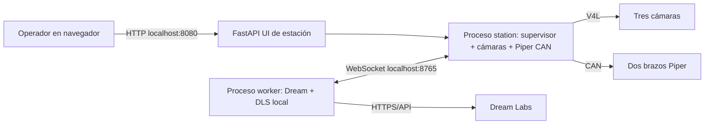
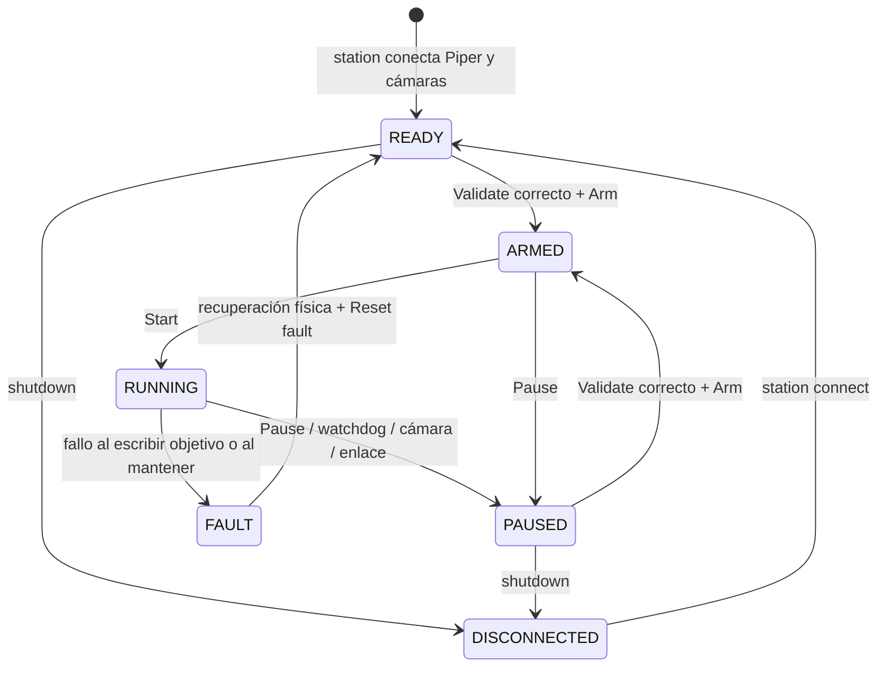

# Aplicación local de operación Piper + Dream-1

Esta guía describe la interfaz que existe hoy, su ciclo operativo y la frontera
que debe conservar la futura aplicación web completa. La implementación actual
vive en `experiments/piper_station_worker`: la estación sirve una consola local
FastAPI con HTML/JavaScript, y es la única dueña de CAN, cámaras y estado del
robot. Aún no hay un frontend React/TypeScript ni un backend de aplicación
separado.

## Arquitectura actual



La UI ejecuta operaciones sobre el objeto `Station`; no abre dispositivos y no
manda objetivos directamente. El worker no es dueño del hardware: recibe
observaciones, solicita chunks Dream, calcula pasos articulares con DLS y envía
acciones por WebSocket. La estación valida sesión, generación, secuencia, edad,
esquema y límites antes de modificar los streamers.

Los procesos escuchan por defecto en loopback. La estación WebSocket usa
`127.0.0.1:8765` y la consola FastAPI `127.0.0.1:8080`. El puerto 8765 no es una
página HTTP; abrirlo en un navegador produce un error de handshake WebSocket.
No se debe publicar el control del robot en una red sin diseñar autenticación,
autorización y transporte seguro.

## Preparar y arrancar

Desde la raíz del repositorio:

```bash
.venv/bin/python -m pip install -r requirements-dream-test.txt
cp .env.example .env
.venv/bin/python -m experiments.piper_station_worker.preflight --check-devices
```

Edita `.env` para la máquina. La clave Dream puede residir allí como
`DREAM_API_KEY` o en el almacén de credenciales del SDK. No guardes una clave
real en `.env.example` ni en Git. El `.env` está ignorado por Git.

Arranca cada proceso en una terminal distinta:

```bash
.venv/bin/python -m experiments.piper_station_worker.station
```

```bash
.venv/bin/python -m experiments.piper_station_worker.worker
```

Abre <http://127.0.0.1:8080>. El worker arranca en modo `action` sin opciones
adicionales. Eso sólo habilita que produzca acciones: la estación no transmite
observaciones de control al worker ni acepta movimiento hasta que el operador
complete la secuencia de validación, armado e inicio en la UI.

Para inspeccionar/inferir sin emitir objetivos, establece
`RSTACK_DREAM_MODE=observe` en `.env`. La estación sigue conectada a CAN y no
deshabilita torque: observación no equivale a un modo eléctrico seguro. Antes de
mover brazos, una persona debe revisar las imágenes y completar la comprobación
de entrada Dream indicada por `dream.input_check`.

## Configuración

Las rutas YAML predeterminadas son:

- `experiments/piper_station_worker/config/robot.yaml`: esquema 14D, límites,
  CAN, cámaras, temporizaciones del supervisor y límites del streamer.
- `experiments/piper_station_worker/config/dream.yaml`: checkpoint, tarea,
  cámaras Dream, frecuencia, horizonte y parámetros DLS.

Las variables reconocidas para el experimento son:

| Variable | Predeterminado | Uso |
| --- | --- | --- |
| `RSTACK_DREAM_MODE` | `action` | `action` o `observe`; prevalece sobre el YAML. |
| `RSTACK_DREAM_MODEL` | valor YAML | Checkpoint de Dream. |
| `RSTACK_DREAM_TASK` | valor YAML | Tarea inicial; la UI puede cambiarla en `READY`/`PAUSED`. |
| `RSTACK_DREAM_STATION_URL` | `ws://127.0.0.1:8765` | WebSocket de estación para el worker. |
| `RSTACK_DREAM_METRICS_WINDOW` | `200` | Número máximo de muestras para percentiles y promedios. |
| `RSTACK_DREAM_UI_HOST` | `127.0.0.1` | Interfaz de escucha FastAPI. Mantener en loopback. |
| `RSTACK_DREAM_UI_PORT` | `8080` | Puerto HTTP de la consola local. |

Las variables exportadas por el proceso prevalecen sobre `.env`; para modo, la
precedencia restante es YAML y después el valor por defecto `action`. El flag
`--config` del worker sirve para seleccionar un YAML alternativo, no es
necesario para habilitar el control. Los flags `--ui-host`, `--ui-port` y
`--no-ui` de la estación permiten ajustar la consola; los valores del entorno
son los predeterminados.

El mapeo físico por defecto es `left → can0`, `right → can1`, y las cámaras se
seleccionan por enlaces persistentes `/dev/v4l/by-path`. Cambia esos dispositivos
en el YAML del robot para otra instalación. Los límites articulares, la
calibración y la geometría deben corresponder al equipo real; no copies a ciegas
un perfil de otra máquina.

## Ciclo de control



### Validar

`Validate` sólo se permite en `READY` o `PAUSED`. Comprueba feedback articular
14D dentro de límites, estado de las tres cámaras y una combinación de frames
recientes dentro de `camera_max_age_ms` y `camera_max_skew_ms`. Sólo si todo pasa
se marca el hardware validado. El permiso se invalida al pausar.

### Armar e iniciar

`Arm` exige el permiso de validación y feedback articulado válido. Crea una
sesión y nueva `control_generation`, para que chunks anteriores no sean válidos.
`Start` sólo está permitido desde `ARMED`; desde ese punto la estación envía
observaciones para control. El worker puede conectarse antes de armar y queda a
la espera. Tras reanudar, el worker limpia su cola anterior y acepta sólo la
nueva generación.

### Pausa, Home y fallos

`Pause` detiene la ejecución y el driver pide mantener la posición medida. No
corta torque. `Home` pausa primero y envía el `home_action` configurado por los
streamers acotados; úsalo sólo con el área despejada. El perfil actual no exige
una confirmación sostenida para Home.

Un watchdog vencido, una cámara inválida o una desconexión del worker causan
pausa y descartan las acciones en cola. Un fallo al enviar un objetivo o al
mantener coloca el supervisor en `FAULT`. La recuperación debe ser física y
explícita; `Reset fault` mantiene la posición y vuelve a `READY`, pero no llama
a `ResetPiper`, no recupera el controlador ni vuelve a habilitar motores. Si el
controlador está en fallo, sostén el brazo y sigue el procedimiento físico de
recuperación antes de resetear y validar de nuevo.

En una salida normal, pausa desde la UI, detén el worker con `Ctrl+C` y después
la estación. Al cerrar, la estación intenta mantener el feedback actual, detiene
cámaras y streamers y desconecta Piper. Si el proceso recibe `Ctrl+C` durante
RUNNING, el cierre de la conexión activa la pausa del supervisor.

## Interfaz HTTP implementada

La consola actual usa estos endpoints. Los errores de operación se devuelven con
HTTP `409` y un `detail` legible.

| Método y ruta | Descripción |
| --- | --- |
| `GET /` | Página de operaciones servida desde `web/index.html`. |
| `GET /api/status` | Estado, sesión, tarea, cámaras, errores, contadores y métricas. |
| `GET /api/cameras/{name}.jpg` | Último frame JPEG (`left`, `top`, `right`); no abre otra cámara. |
| `POST /api/validate` | Comprueba feedback y frames. |
| `POST /api/task` | Cuerpo JSON `{"task":"..."}`; sólo en `READY` o `PAUSED`. |
| `POST /api/arm` | Arma y devuelve el identificador de sesión. |
| `POST /api/start` | Inicia desde `ARMED`. |
| `POST /api/pause` | Mantiene y pausa. |
| `POST /api/home` | Pausa y ejecuta la postura Home configurada. |
| `POST /api/reset-fault` | Intenta mantener y restablece `FAULT` a `READY`. |

La UI refresca estado y vistas periódicamente, bloquea edición de tarea durante
la ejecución y deshabilita botones que no corresponden al estado. La estación
vuelve a validar todas las transiciones: deshabilitar un botón no es una
protección de seguridad.

## Métricas disponibles

`GET /api/status` tiene métricas del proceso estación en `metrics` y telemetría
del worker en `rtc` cuando éste envía `rtc_status`:

- `inference_last_ms`, `inference_mean_ms`, `inference_p50_ms`,
  `inference_p95_ms`, `inference_max_ms` y `samples`: ventana móvil de duración
  end-to-end de cada chunk, incluyendo el procesamiento local asociado.
- `timing` y `rtt_ms`: desglose que entrega el cliente Dream, incluido tiempo
  remoto y red cuando esté disponible.
- `observation_hz`, `action_hz`, `queue_depth`, `queue_high_water` y
  `counts.underruns`: ritmo, ocupación y faltantes de la cola del worker.
- `counts`, `rejections`, `error` y `worker_heartbeat_age_ms`: actividad,
  rechazos y señal temporal de la última inferencia.
- `accepted_actions`, `rejected_actions`, `observation_failures` y
  `cameras.*.age_ms`: conteos y frescura del lado de estación.

El RTT es el valor del SDK Dream, no una medida independiente de la estación.
Los percentiles se calculan sobre la ventana más reciente, cuyo tamaño se fija
con `RSTACK_DREAM_METRICS_WINDOW`. Si `samples` es cero, el worker aún no ha
aceptado un chunk. Una latencia baja no demuestra que la acción sea correcta ni
que el encuadre de cámaras esté validado.

## Aplicación web completa prevista

El frontend integrado actual es una consola temporal. Al convertirla en una app
completa, conservar una sola autoridad de hardware y separar UI, API y estación:

```text
React + TypeScript + shadcn/ui + Tailwind
                 │ HTTP + SSE, localhost
                 ▼
FastAPI: schemas, auth local opcional, OpenAPI, estáticos
                 │ IPC local tipado
                 ▼
Piper station: supervisor + cámaras + CAN
                 │ WebSocket de observación/acciones
                 ▼
Dream worker
```

El navegador nunca debe importar Piper SDK ni adquirir CAN/V4L. FastAPI no debe
mantener una segunda máquina de estados: debe traducir solicitudes a comandos
tipados de estación y presentar respuestas. Para producción local, usar
FastAPI estable vigente, Pydantic v2 y un lockfile de Python; frontend con
TypeScript estricto, Vite, Tailwind y shadcn/ui; generar tipos TS desde
`/openapi.json`. Mantener un único origen local en loopback, sin CORS amplio.

La API objetivo puede exponer estos recursos sin reemplazar la API temporal
`/api/*` antes de que el backend IPC esté implementado:

| Método y ruta objetivo | Contrato |
| --- | --- |
| `GET /healthz`, `GET /readyz` | Liveness y disponibilidad de FastAPI/estación. |
| `GET /v1/station/status` | Estado, causas de bloqueo, cámaras, CAN, worker, calibración y métricas. |
| `GET /v1/station/cameras/{name}.jpg` | Último JPEG capturado por la estación. |
| `POST /v1/station/validate` | Revalida preflight y salud del hardware sin mover brazos. |
| `PUT /v1/station/task` | Actualiza tarea sólo en `READY`/`PAUSED`. |
| `POST /v1/station/arm`, `POST /v1/station/start` | Solicita transiciones permitidas a la estación. |
| `POST /v1/station/pause` | Pausa inmediata; sin modal ni confirmación previa. |
| `POST /v1/station/home`, `POST /v1/station/fault/reset` | Operaciones sensibles con confirmación y validación remota. |
| `GET /v1/station/events` | Eventos SSE de estado y métricas; imágenes por endpoint JPEG. |

La capa FastAPI hablará con la estación por IPC local tipado, preferentemente
socket Unix con permisos del usuario operador. Mensajes petición/respuesta
llevarán `request_id`; la respuesta incluirá `ok`, estado y un código legible.
FastAPI no abrirá imports del driver ni accederá a cámaras/CAN. Respuestas
propuestas: `422` para payload inválido, `409` para transición no permitida,
`503` si la estación no está disponible y `429` para una operación concurrente
que no se puede aceptar.

`start`, `home` y `fault/reset` pueden pedir
`safety_acknowledged: true`; `home` y `fault/reset` también pueden exigir que
la UI mida una pulsación sostenida de al menos dos segundos. Esa interacción
reduce errores accidentales, pero no sustituye los permisos ni la validación
del supervisor en la estación.

La futura UI debe conservar previews con edad, enlace/estado de CAN, validación,
tarea, sesión, latencia/RTT, tasas, cola, rechazos y causa del último fallo. Las
acciones de riesgo deben tener confirmación explícita en UI, pero el backend y
la estación siempre vuelven a comprobar estado y prerrequisitos. `Pause` debe
estar accesible inmediatamente.

Durante desarrollo, Vite debe proxificar `/v1`, `/healthz`, `/readyz` y SSE a
FastAPI. Para el despliegue local, servir el build de Vite con FastAPI para
conservar el mismo origen. La pantalla inicial debe mostrar estado y causa de
bloqueo, cámaras con edad, estado de hardware y worker, tarea, telemetría y
controles cuyo estado habilitado deriva de `/status`. El cliente TypeScript debe
usar TanStack Query para consultas/mutaciones, `EventSource` para eventos y
tipos generados desde OpenAPI; no mantener modelos duplicados a mano.

Antes de reemplazar la consola temporal, implementar y probar contratos de
transición, estados de indisponibilidad, errores `409`/`503`, control de
peticiones repetidas, desconexión/reconexión del worker, SSE y manejo de cámara.
Las pruebas de API y frontend deben usar estación y cámaras simuladas; ninguna
prueba automatizada debe habilitar movimiento físico.
