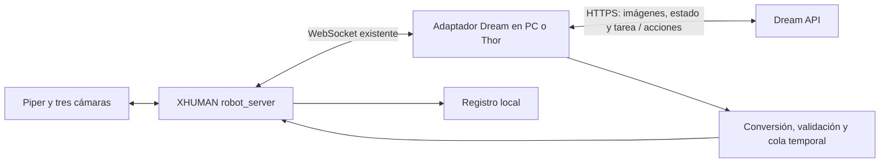

# Dream-1 → NONHUMAN / XHUMAN

Plan inicial de adaptación, revisado el 2026-11-07. La implementación activa
experimental vive en `experiments/piper`; el SDK se instala desde PyPI, sin una
copia de su monorepo aquí.

Actualización: se consolidó el driver activo y la [guía de setup Piper](SETUP_PIPER.md).
Incluye selección de cadena URDF, fuente ZED monocular, streaming limitado y
pruebas offline. El driver moderno
`xhuman/robots/piper/driver.py` ya trabaja en radianes; la conversión normalizada
descrita más abajo corresponde específicamente a `bi_piper_follower`. No existe
todavía un adaptador activo validado con hardware ni un puente Dream por WebSocket.

## 1. Qué ofrece Dream Labs

Dream-1 es un World Action Model: aprende conjuntamente predicción de vídeo y acciones. Dream Labs reporta transferencia zero-shot a robots bimanuales con pinzas paralelas, utilizando poses de los efectores finales y cinemática inversa (IK). Eso permite compartir una representación entre cuerpos distintos, aunque el resultado depende de la IK y del espacio alcanzable. Su artículo presenta el sistema como una beta de investigación; sus demostraciones no garantizan éxito en nuestro Piper. También ofrece adaptación mediante Fine-tuning-as-a-Service (FaaS). [Investigación oficial](https://dreamlabs.ai/research/dream-1/).

La integración pública es mediante API. El repositorio encontrado contiene el SDK, CLI, herramientas de robots e IK; no contiene los pesos ni el entrenamiento completo del modelo Dream-1. DreamZero es un antecedente diferente y no debe confundirse con este checkout. [Repositorio oficial](https://github.com/dreamlabs-co/dreamlabs).

## 2. Checkout y workspace reales

| Elemento | Ubicación / revisión |
| --- | --- |
| Este checkout | `/home/mwkoc/GITHUB/mu-robotics/dream-1` |
| Origin actual | `https://github.com/MwkOC/dream1-piper.git` |
| Commit Dream Labs | `2d2f5239eb737c9271e15054637fe952758d5823` |
| SDK inspeccionado | `dreamlabs-client` 1.0.9 |
| Workspace NONHUMAN | `/home/mwkoc/GITHUB/nonhuman/XHUMAN` |
| Commit XHUMAN | `9a43fcfd25c1c582c806654bedc2daeb4599ed02` |

No existe `/home/mwkoc/GITHUB/xhuman` en este equipo. Se interpreta la referencia del usuario como el proyecto XHUMAN dentro de `nonhuman`. También existe `GITHUB/NoHuman`, pero es otro árbol y no se mezcla en esta propuesta.

El checkout oficial fue el punto de partida y permanece en el historial Git.
Ahora se mantiene solo la integración, con `dreamlabs==1.0.18` y
`dreamlabs-client==1.0.9` instalados desde PyPI en `.venv`.

## 3. Puntos de integración comprobados

Rutas relativas a `/home/mwkoc/GITHUB/nonhuman/XHUMAN`:

| Componente existente | Uso propuesto |
| --- | --- |
| `scripts/inference/robot_server.py` | Mantener la propiedad de cámaras, CAN y ejecución de acciones |
| `xhuman/inference/remote/client.py` | Reutilizar `RemoteRobotClient`: conectar, obtener observación, enviar acción, recibir tarea y publicar estado |
| `xhuman/inference/remote/protocol.py` | Conservar `hello`, `get_observation`, `send_action`, `set_task`, `status` |
| `scripts/inference/policy_server.py` | Referencia del bucle existente; exige una política LeRobot, por lo que un ID Dream no puede usarse directamente como `--policy.path` |
| `xhuman/robots/bi_piper_follower/bi_piper_follower.py` | Dos brazos con seis articulaciones y pinza; nombres semánticos por lado |
| `xhuman/robots/piper/piper_sdk_interface.py` | Conversión normalizada/CAN, signos, límites por firmware y calibración de pinza |
| `assets/piper/piper.urdf` | Modelo candidato para IK; verificar contra la versión física |
| `xhuman/robots/piper/gripper_calibration.py` | Reutilizar calibración de apertura por lado |
| `bin/inference/defaults.sh` | WebSocket puerto 8765 y red USB-C PC/Thor |
| `scripts/vr_teleop_record.py` y `docs/README_record.md` | Punto de partida para grabar demostraciones |

## 4. Arquitectura mínima propuesta

Implementar un lanzador dedicado `scripts/inference/dream_policy_server.py` y un módulo pequeño `xhuman/inference/dream_adapter.py`. Son archivos propuestos, no existentes. Reutilizar el transporte de XHUMAN y la API pública `dream.DreamClient`; no añadir un servidor HTTP ni una política entrenable ficticia.

Primero ejecutar el adaptador en el PC. La Thor puede alojarlo más adelante usando `ws://192.168.55.100:8765`, pero necesita salida a Internet: la red USB-C no la garantiza. La inferencia del modelo sigue siendo remota; la GPU de la Thor no aloja Dream-1 con este SDK.

## 5. Fase A — entorno y contrato reproducibles

1. Registrar ambos commits, versión Python, dependencias efectivas de XHUMAN y configuración física. XHUMAN depende de LeRobot desde Git sin revisión fija: conservar la versión instalada antes de comparar resultados.
2. Usar Python 3.12 en un entorno de integración independiente. Revisar resolución de dependencias antes de instalar ambos proyectos; no actualizar el entorno operativo del robot.
3. Instalar `requirements.txt` en el entorno del proyecto. El paquete completo `dreamlabs` trae la IK y `dreamcli`; el cliente mínimo por sí solo no incluye todo el stack.
4. Obtener la clave desde la plataforma y proporcionarla mediante `DREAM_API_KEY` o el archivo de credenciales del SDK. No guardarla en el repositorio.
5. Consultar `client.get_models()` para seleccionar el checkpoint real disponible. El artículo usa `dreamlabs/dream-1`, mientras algunos ejemplos del checkout usan `dreamlabs/dream-1-beta`: no asumir que ambos IDs son intercambiables.

Salida: entorno reproducible y configuración explícita, sin arrancar drivers. Construir `PiperSDKInterface` conecta CAN y habilita motores; una prueba sin hardware debe usar fixtures o mocks, no instanciarlo.

## 6. Fase B — cámaras, unidades y cinemática

### Observaciones

| XHUMAN | Dream | Transformación |
| --- | --- | --- |
| Cámara general configurada en XHUMAN | `video.overhead` | JPEG base64 sin prefijo `data:` |
| Cámara muñeca izquierda | `video.wrist_l` | Comprobar lado físicamente |
| Cámara muñeca derecha | `video.wrist_r` | Comprobar lado físicamente |
| Seis posiciones `left_*.pos` | `state.left_arm` | Normalización → unidades físicas → convención URDF, float32 |
| Seis posiciones `right_*.pos` | `state.right_arm` | Misma conversión con límites del brazo derecho |
| Pinza por lado | Clave exigida por configuración/checkpoint | Apertura calibrada 0 cerrado, 1 abierto |
| Tarea recibida por `set_task` | `prompt` | Texto de tarea del episodio |

El SDK documenta imágenes 320×176, JPEG calidad 85 y timestamps monotónicos. Configurar los nombres de cámaras explícitamente; no inferirlos del orden de un diccionario. Verificar RGB/BGR y sincronización con el estado. Mantener observaciones actualizadas durante la llamada de inferencia; el cliente conserva su propia ventana temporal.

El ejemplo YAM usa `state.left_gripper` / `state.right_gripper`; otras rutas IK documentan `state.<side>_grip`. Determinar las claves mediante la configuración y pruebas del checkpoint elegido, sin mezclar contratos.

### Articulaciones

Orden semántico XHUMAN: `shoulder_pan`, `shoulder_lift`, `elbow_flex`, `forearm_roll`, `wrist_flex`, `wrist_roll`, seguido de `gripper`, con prefijos `left_` o `right_` y sufijo `.pos`.

XHUMAN usa articulaciones en [-100, 100] y pinza en [0, 100]. El SDK CAN emplea milésimas de grado y milésimas de milímetro. Los límites `min_pos/max_pos` internos se expresan en décimas de grado y la implementación aplica `JOINT_SIGNS = (-1, 1, 1, -1, 1, -1)`.

Para una posición normalizada `u`, la coordenada interna firmada en décimas de grado es `t = min_pos + (max_pos - min_pos) * (u + 100) / 200`. Esto no basta para obtener la coordenada URDF: validar signos, orden y offsets con poses físicas conocidas, y convertir grados a radianes después. Implementar la inversa a partir del mismo mapa, con límites por brazo. No duplicar una inversión que ya hace el driver.

La pinza requiere validar extremos medidos y sentido de apertura. No tratar milímetros como radianes ni enviar radianes directamente a `send_action` de XHUMAN.

### IK para Piper

El cliente admite `ik.arm` como ruta a un JSON de brazo personalizado. Debe contener `urdf`, `base`, `flange`, `tcp`, `approach`, `jaw` y `rest`. Usar la cadena correcta del URDF y `head: "eef"` para transferencia desde un modelo YAM a Piper. No usar las acciones articulares YAM como posiciones Piper.

Medir físicamente el TCP entre los dedos y confirmar ejes, pose de reposo, separación de bases y transformación del montaje. El TCP no se estima a partir de una imagen ni se rellena con un valor arbitrario. Son datos pendientes del hardware, no un requisito para redactar este plan.

Validar FK/IK con poses alcanzables, límites y posiciones cercanas a mesa y brazo opuesto. Las restricciones del SDK no sustituyen una comprobación de colisiones del conjunto.

Salida: tabla de calibración por brazo y pruebas de ida/vuelta; poses IK revisadas sin mandar movimiento.

## 7. Fase C — bucle de acciones

1. Conectar `RemoteRobotClient` y comprobar `hello`, nombres de acciones, dimensiones y cámaras.
2. Configurar `DreamClient.policy(config)` con checkpoint disponible, IK Piper y esquema de embodiment. Mantener `strict=True`; el SDK indica que sin esquema no hay validación y que el esquema no comprueba valores numéricos.
3. Alimentar `set_observation(frames, observation, timestamp=...)` en un bucle de captura. Usar un único worker para `get_action()`; no admitir llamadas concurrentes.
4. Validar resultado, dimensiones, valores finitos, límites articulares y velocidad. El cliente puede entregar `q_l_chunk` / `q_r_chunk` con forma `[H, 7]`; modelos adaptados pueden usar `per_key`. Implementar solo el formato confirmado, con rechazo explícito del resto.
5. Convertir cada fila al diccionario completo de 14 acciones XHUMAN. No omitir articulaciones: el follower actual rellena claves ausentes con cero.
6. Ejecutar con reloj monotónico y cola acotada; usar `client.refill_due(executed, remaining)` y la frecuencia configurada. El checkout tiene `action_hz=20` y `execution_horizon=30` por defecto, mientras XHUMAN usa frecuentemente 30 Hz. Acordar la frecuencia antes de ejecutar; no reproducir el mismo chunk más rápido por reutilizar el default del otro stack.
7. Empezar sin RTC ni HLP de XHUMAN: el SDK ya procesa las transiciones entre chunks. Añadir wrappers solo tras medir el comportamiento básico.
8. Al cambiar tarea, detener la cola anterior, invalidar respuestas en vuelo con un identificador de episodio y llamar `reset_episode()`. Una respuesta de la tarea anterior nunca debe convertirse en movimiento nuevo.
9. Ante timeout, sesión expirada, desconexión, cámara antigua, cola agotada o respuesta inválida: descartar comandos pendientes y aplicar el comportamiento de parada validado para Piper. No asumir que dejar de enviar mensajes detiene el robot.
10. Incorporar watchdog del lado del robot: si muere el adaptador o se corta el WebSocket, la reacción no puede depender de otro mensaje desde ese proceso. Probar parada física y recuperación explícita antes de un ensayo autónomo.

Registrar acciones propuestas, enviadas y estado medido por separado: un envío WebSocket exitoso no demuestra ejecución física. Guardar latencia `last_timing`, duración de cola, edad de observación, rechazos y causa de parada.

## 8. Fase D — validación gradual

| Etapa | Prueba | Criterio para avanzar |
| --- | --- | --- |
| Offline | Fixtures de observación y respuesta; conversiones ida/vuelta, lados y pinzas | Dimensiones correctas, error dentro de tolerancia declarada y rechazo de NaN/Inf/claves ausentes |
| IK sin motores | Replay de poses en URDF y revisión visual | Poses alcanzables y límites respetados; TCP y convenciones confirmados |
| Contrato API | Un episodio grabado, sin `send_action` | Checkpoint accesible y respuesta compatible; registrar latencia real |
| Shadow | Cámaras/estado reales; acciones solo al log | Sin datos antiguos, saltos o comandos fuera de espacio permitido |
| Hardware supervisado | Tarea corta y objetos blandos, velocidad limitada | Parada y watchdog probados; ninguna ejecución de episodios obsoletos |
| Evaluación | Mismas tareas y condiciones que política XHUMAN de referencia | Reportar éxito completo, intervenciones, tiempo, latencia p50/p95 y coste |

Propuesta de evaluación inicial: tres tareas simples, diez ensayos por tarea y política, con posiciones iniciales documentadas. No presentar esta muestra como evidencia de generalización universal. Fijar tolerancias, velocidad máxima y umbrales de antigüedad según el robot y la medición de red antes del ensayo, no inventarlos en el adaptador.

## 9. Fase E — adaptación con demostraciones si hace falta

1. Grabar teleoperación con XHUMAN: tres vistas, estado, acciones, tarea y episodios completos.
2. Exportar una copia a LeRobot v2.1, formato que valida este SDK. No asumir que la versión LeRobot instalada produce ese formato; inspeccionar `meta/info.json`.
3. Declarar los spans `[start, end)` de estado y acción con el orden real del dataset. La API muestra ejemplos derecha-izquierda y el follower construye izquierda-derecha: no copiar offsets sin reordenar los vectores.
4. Conservar fps, nombres de features y sincronización. Incluir `meta/tasks.jsonl`, parquet y vídeos por episodio; reservar episodios para evaluación.
5. Ejecutar `client.validate_dataset(path, config)` localmente. Corregir errores antes de subir datos.
6. Para entrenamiento remoto: `add_embodiment` → `upload_dataset` → esperar `processed` → `finetune` → consultar estado → seleccionar el ID resultante. No confundir el nombre del dataset con su ID de seguimiento.
7. Si se usa `use_eef=True`, generar las partes EEF exigidas con la convención documentada, metros y rotación `rot6`, desde una FK validada.
8. Evaluar contra el baseline zero-shot con tareas/episodios reservados. Las demostraciones del proveedor con pocos minutos no determinan cuántos datos necesitará este robot.

Esta fase supone envío de vídeos/estado a un servicio externo y uso facturable. En esta tarea no se han enviado datos, creado jobs ni hecho llamadas de inferencia.

## 10. Entregables de la implementación futura

- Adaptador y lanzador dedicados, con modo sin envío de acciones como primera ruta de prueba.
- Configuración de cámaras, conversión y brazo Piper basada en mediciones.
- Pruebas de contrato, conversiones, cola, cambio de tarea y desconexión.
- Watchdog y parada verificados en el servidor de robot.
- Informe comparativo con revisión del SDK, checkpoint, calibración y resultados reproducibles.
- Exportador de datasets solo si se decide ejecutar FaaS.

Orden recomendado: contrato offline → cinemática → API sin actuación → watchdog y shadow → prueba supervisada → evaluación → FaaS si el resultado lo justifica.

## Fuentes y límites de esta revisión

- [Investigación Dream-1](https://dreamlabs.ai/research/dream-1/).
- [Repositorio oficial](https://github.com/dreamlabs-co/dreamlabs).
- [Contrato del cliente oficial](https://github.com/dreamlabs-co/dreamlabs/blob/2d2f5239eb737c9271e15054637fe952758d5823/dream_library/dream_client/README.md): API, temporización, brazo personalizado y datasets.
- [Dependencias fijadas de esta integración](../requirements.txt).
- [Guía local de inferencia XHUMAN](/home/mwkoc/GITHUB/nonhuman/XHUMAN/docs/source/guides/inference.md).
- [Driver Piper inspeccionado](/home/mwkoc/GITHUB/nonhuman/XHUMAN/xhuman/robots/piper/piper_sdk_interface.py).

Se verificaron las rutas, código y revisión del clone. No se probaron credenciales, servicio remoto, resolución de dependencias, calibración física ni funcionamiento del robot. El principal riesgo técnico es una conversión incorrecta de unidades/convenciones o ejecutar acciones obsoletas; ambos deben quedar cubiertos antes de habilitar movimiento.
