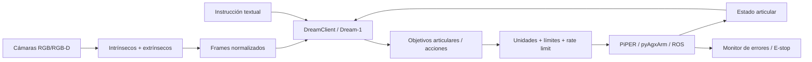

# Piper con Dream Labs: integración, coordenadas, ángulos y calibración de cámaras

## Resumen ejecutivo y alcance

La evidencia disponible indica que, en este contexto, **“Piper” debe interpretarse como el brazo robótico AgileX PiPER/PiPER SDK**, no como el sintetizador de voz Piper ni como otro paquete homónimo. Dream Labs menciona explícitamente a **“PiPER, two arms — AgileX Robotics”** entre los robots evaluados con Dream-1 y reporta un rendimiento simulado relativo de 91,2 % frente a YAM. Dream-1 recibe imágenes de cámaras, estado articular e instrucción textual y devuelve objetivos de acción para el robot. citeturn253752search1turn253752search2

**Supuestos no especificados por el usuario:** no se indicó versión concreta de PiPER, `piper_sdk`/`pyAgxArm`, firmware, sistema operativo, modelo de cámara, configuración mono/bimanual ni si la cámara es fija (`eye-to-hand`) o está montada en muñeca (`eye-in-hand`). En consecuencia, este informe usa como referencia el PiPER actual de AgileX, Linux/ROS 2 cuando es necesario hablar de TF/calibración, OpenCV para calibración geométrica y la biblioteca pública `dreamlabs` vigente a 9 de noviembre de 2026. PyPI muestra `dreamlabs` 1.0.37 publicada el 7 de noviembre de 2026; el paquete requiere Python 3.11-3.13 y está orientado a POSIX/Linux. citeturn864681view0turn181950search3

La conclusión técnica principal es que la integración debe tratar **tres capas con convenciones explícitas**:

1. **Hardware/PiPER:** articulaciones, cinemática, CAN, límites y pose del flange.
2. **Percepción/calibración:** intrínsecos de cada cámara y, cuando se necesiten coordenadas métricas, transformaciones rígidas cámara↔robot.
3. **Dream Labs:** observaciones visuales + estado articular → acciones, evitando conversiones ambiguas en la frontera entre su representación y la de PiPER. Dream Labs ofrece dos rutas: `dreamcli`, que administra la estación, cámaras y brazos, o `dream.DreamClient`, para integrar Dream-1 en un bucle propio. citeturn864681view0turn812107search2

Un riesgo especialmente importante es **mezclar unidades o referencias**. El SDK PiPER clásico expone muchos valores como enteros en **0,001 grados** y posiciones cartesianas en **0,001 mm**, mientras que el nuevo `pyAgxArm` expone poses cartesianas en **metros y radianes**. Ese cambio de interfaz puede producir errores de factores 1.000, π/180 o incluso 10⁶ si se reutiliza código sin adaptar. citeturn676144search1turn676144search7

La referencia “sexagesimal” merece una aclaración: **no encontré evidencia de que PiPER o Dream Labs utilicen notación sexagesimal**. En robótica, los formatos pertinentes son grados, radianes, Euler/RPY, vectores de rotación y cuaterniones. La notación grados-minutos-segundos es propia sobre todo de astronomía/geodesia; se incluye más adelante solo como mecanismo de importación/normalización si el usuario recibe datos externos de ese tipo. citeturn830051search5turn830051search9

## Documentación oficial y recursos recuperados

AgileX mantiene un centro oficial de documentación que enlaza el manual de usuario y la ficha técnica de PiPER. El manual vigente recuperado es un PDF de 66 páginas, versión indicada en el propio documento como **V1.0, 2025.06**, e incluye sistemas de coordenadas, posición cero, CAN, software ArmRobotUA, control de movimiento y desarrollo secundario. citeturn864681view3turn332869view0

| Archivo | URL | Procedencia | Contenido relevante |
|---|---|---|---|
| `PIPER_Product_User_Manual_EN_1.pdf` | `https://cdn.shopify.com/s/files/1/0551/0630/6141/files/PIPER_Product_User_Manual_EN_1.pdf?v=1794214904` | AgileX oficial | Manual de 66 páginas: coordenadas de base, cero mecánico, CAN, host ArmRobotUA, movimiento y seguridad. El manual define el sistema de usuario como el sistema de coordenadas de la base. citeturn332869view0turn536867view0 |
| `PiPER_Product_Sheet.pdf` | `https://cdn.shopify.com/s/files/1/0551/0630/6141/files/PiPER_Product_Sheet.pdf?v=1792058094` | AgileX oficial | Especificaciones rápidas: 6 DoF, 1,5 kg de carga, alcance ~626 mm, repetibilidad ±0,1 mm, CAN, compatibilidad Python/ROS/ROS 2. citeturn728817view0turn759905view0 |

Los dos PDFs fueron **recuperados y analizados mediante el navegador de investigación**; el entorno de ejecución no permitió persistir una copia binaria descargable en `/mnt/data`, por lo que no invento enlaces locales a archivos que no existen.

La documentación de software más importante es el repositorio oficial `agilexrobotics/piper_sdk`. AgileX presenta allí el SDK como software para controlar el brazo, documenta instalación vía `pip`, GitHub o wheel, ofrece documentación V2/V3, ejemplos y utilidades para dos brazos. El propio repositorio señala además la transición hacia el nuevo `pyAgxArm`. citeturn536867view2

Para Dream Labs, la fuente pública más directa es PyPI y la documentación oficial enlazada desde allí. El paquete `dreamlabs` instala la estación completa; `dreamlabs-client` instala únicamente `import dream`. La secuencia oficial mínima es:

```bash
pip install dreamlabs
dreamcli setup
dreamcli robot up
```

`dreamcli setup` configura brazos y cámaras y escribe `~/.dreamlabs/station.yaml`; `dreamcli robot up`, `log` y `down` administran la estación. Para un bucle propio:

```bash
pip install dreamlabs-client
export DREAM_API_KEY=dl_live_...

python - <<'PY'
import dream
client = dream.DreamClient()
print(client)
PY
```

La documentación pública explica que `set_observation()` mantiene las imágenes/observaciones y `get_action()` obtiene la acción de la política configurada. citeturn812107search2turn864681view0

### Arquitectura recomendada

El flujo siguiente no aparece como un “adaptador PiPER oficial” publicado por Dream Labs; es una **arquitectura de integración derivada** de las interfaces documentadas de ambas partes. Dream Labs ha demostrado PiPER en simulación, pero sus fuentes públicas consultadas no documentan un plugin físico PiPER específico listo para usar. citeturn253752search1turn181950search0



## Posicionamiento absoluto, relativo y sistemas de referencia

El manual PiPER establece que el **sistema de coordenadas de usuario coincide con el sistema de coordenadas de la base del brazo**. También documenta una posición cero concreta y el software ArmRobotUA muestra campos `X/Y/Z` y `RX/RY/RZ`, junto con incrementos `ΔX`, `ΔY`, `ΔZ`, etc. citeturn332869view0turn611198view2turn536867view0

Eso lleva a una distinción práctica fundamental:

**Movimiento absoluto:** se ordena una pose objetivo completa expresada respecto al marco de base. Por ejemplo, en `pyAgxArm`, `move_p([x,y,z,roll,pitch,yaw])` recibe `x,y,z` en metros y RPY en radianes; la implementación convierte internamente metros a unidades del protocolo y radianes a miligrados. citeturn993553search0turn676144search7

```python
# Ejemplo conceptual con pyAgxArm
target = [
    0.35,    # x [m]
    0.10,    # y [m]
    0.25,    # z [m]
    0.0,     # roll [rad]
    1.20,    # pitch [rad]
    0.0      # yaw [rad]
]

robot.move_p(target)
```

**Movimiento relativo:** no debe confundirse con enviar `Δx, Δy, Δz` a una API que espera una pose absoluta. En ausencia de una primitiva explícitamente relativa, la forma segura es obtener la pose actual, aplicar el incremento **en el marco correcto** y enviar la pose resultante.

```python
import numpy as np

current = np.array(robot.get_flange_pose().msg, dtype=float)

delta = np.array([
    0.020,   # +20 mm en X
    0.000,
    0.000,
    0.000,
    0.000,
    0.000
])

target = current + delta
robot.move_p(target.tolist())
```

Ese código es válido para **traslaciones pequeñas expresadas en el mismo marco**. No es una implementación general correcta para sumar orientaciones arbitrarias: las rotaciones deben componerse mediante matrices/cuaterniones, no mediante suma de Euler cuando los incrementos son grandes o se desean incrementos en el marco de la herramienta.

Para una transformación rígida:

\[
{}^{B}T_{C} =
\begin{bmatrix}
R & t\\
0 & 1
\end{bmatrix}
\]

y un punto de cámara \(p_C\):

\[
p_B = {}^{B}T_C\,p_C
\]

La misma regla aparece repetidamente en discusiones de robótica: si la cámara está sobre la herramienta, primero se obtiene la transformación cámara→herramienta mediante hand-eye y luego se compone con la cinemática herramienta→base. citeturn882681search4turn882681search5

Un error frecuente es mezclar **marco base** y **marco herramienta**. Si se desea “avanzar 20 mm en la dirección a la que apunta la pinza”, el vector debe rotarse con la orientación actual:

```python
import numpy as np
from scipy.spatial.transform import Rotation

p = np.array([x, y, z])
R_bt = Rotation.from_euler("xyz", [roll, pitch, yaw]).as_matrix()

# 20 mm a lo largo del eje +X de la herramienta
delta_tool = np.array([0.020, 0.0, 0.0])

delta_base = R_bt @ delta_tool
p_target = p + delta_base
```

### Problemas observados en PiPER

Hay evidencia reciente de problemas en los que la pose reportada puede no equivaler a la realidad física. En el issue oficial #120, un usuario documenta divergencia silenciosa entre posición física y posición reportada después de aplicar torque externo, recuperándose tras reset `0x150`; el comportamiento descrito sugiere que confiar solo en feedback de encoder interno puede ocultar una pérdida de referencia física. citeturn993553search4

El issue #35 describe que trayectorias grabadas funcionan repetidamente durante una sesión pero aparecen desplazadas tras apagar y volver a encender; AgileX pidió verificar firmware y contactar soporte para el problema de recalibración tras repowering. citeturn993553search5

El issue #127 documenta incluso diferencias de **2-3 cm entre dos unidades PiPER** ejecutando la misma trayectoria cartesiana y cuestiona si es necesario recalibrar offsets/cero por unidad. Esto es especialmente importante en una configuración Dream-1 bimanual: dos brazos nominalmente idénticos no deben asumirse intercambiables sin validación geométrica. citeturn993553search3

## Conversión de ángulos y trampas de representación

La situación de PiPER es particularmente propensa a errores porque **coexisten dos interfaces con unidades distintas**.

En el `piper_sdk` tradicional, `GetArmEndPoseMsgs()` devuelve posición en 0,001 mm y orientación Euler en 0,001°. `JointCtrl` utiliza igualmente 0,001° para las articulaciones. citeturn676144search0turn676144search1

```python
# piper_sdk clásico: 30 grados -> 30000 miligrados
angle_deg = 30.0
sdk_value = round(angle_deg * 1000)

# Feedback 45000 -> 45 grados
feedback = 45000
angle_deg = feedback / 1000.0
```

En cambio, el nuevo driver `pyAgxArm` documenta `move_p()` con RPY en **radianes**, y convierte internamente a los campos de protocolo en 0,001°. citeturn993553search0turn676144search7

```python
import math

deg = 30.0
rad = math.radians(deg)       # 0.523598...
deg2 = math.degrees(rad)      # 30.0
```

Nunca debe hacerse esto:

```python
# ERROR: 90 se interpreta como 90 radianes
robot.move_p([0.3, 0.0, 0.3, 0, 90, 0])
```

sino:

```python
robot.move_p([
    0.3, 0.0, 0.3,
    math.radians(0),
    math.radians(90),
    math.radians(0),
])
```

`pyAgxArm` impone límites de RPY: roll/yaw dentro de `[-π, π]` y pitch dentro de `[-π/2, π/2]`, por lo que el ejemplo incorrecto normalmente debe producir una validación de rango en lugar de un movimiento válido. citeturn993553search0

AgileX también ha tenido discrepancias documentales de unidades. En el issue #122, el comentario del SDK indicaba `0.001 rad/s` mientras que el protocolo decía `0.01 rad/s`; AgileX confirmó que **0.01 rad/s era correcto para ese caso** y reconoció que el comentario de GitHub era erróneo. El changelog posterior aclara además que la unidad cambia según versión de firmware: antes de V1.5-8 se usaba 0,001 rad/s y a partir de V1.5-8, 0,01 rad/s. citeturn993553search6turn676144search8

Por ello, conviene fijar las conversiones en una sola capa:

```python
from dataclasses import dataclass
import math

@dataclass
class JointStateSI:
    radians: list[float]

def piper_millideg_to_si(raw):
    return JointStateSI([
        math.radians(v / 1000.0)
        for v in raw
    ])

def si_to_piper_millideg(rad_values):
    return [
        round(math.degrees(v) * 1000)
        for v in rad_values
    ]
```

### Euler, orden de rotación y cuaterniones

No basta con decir “son radianes”. El orden también importa. `pyAgxArm` documenta la pose como rotaciones extrínsecas XYZ equivalentes a una composición intrínseca ZYX:

\[
R = R_z(yaw)\,R_y(pitch)\,R_x(roll)
\]

citeturn676144search7

ROS y MoveIt suelen representar una pose como posición XYZ + cuaternión XYZW; una discusión de Stack Overflow resume correctamente que el cuaternión codifica solo orientación, mientras que la posición se especifica por separado. citeturn882681search10

```python
from scipy.spatial.transform import Rotation

rpy = [roll, pitch, yaw]

quat_xyzw = Rotation.from_euler("xyz", rpy).as_quat()

rpy_recovered = Rotation.from_quat(quat_xyzw).as_euler("xyz")
```

No compare Euler componente a componente para verificar una orientación, porque la misma orientación admite múltiples representaciones Euler y aparecen discontinuidades cerca de ±π. Compare matrices o cuaterniones normalizados.

### Sexagesimal

No encontré ningún uso documentado de sexagesimal en PiPER o Dream Labs. Si una fuente externa entrega, por ejemplo, `12° 30′ 15″`, la conversión es:

\[
d_\text{decimal}=d+\frac{m}{60}+\frac{s}{3600}
\]

La documentación astronómica consultada emplea exactamente esta relación y recuerda que 1 grado = 60 minutos de arco y 1 minuto = 60 segundos de arco. citeturn830051search9turn830051search8

```python
import math

def dms_to_degrees(sign, d, m, s):
    value = abs(d) + m/60.0 + s/3600.0
    return -value if sign < 0 else value

def dms_to_radians(sign, d, m, s):
    return math.radians(dms_to_degrees(sign, d, m, s))

print(dms_to_degrees(1, 12, 30, 0))
# 12.5
```

La trampa clásica con valores negativos es aplicar el signo solo a los grados:

```python
# MAL para -12°30'
-12 + 30/60       # -11.5

# BIEN
-(12 + 30/60)     # -12.5
```

## Calibración de cámara paso a paso

Conviene separar dos operaciones distintas:

**Calibración intrínseca:** estima focales, centro óptico y distorsión de la lente. OpenCV recomienda múltiples imágenes del patrón; su tutorial indica al menos unas 10 vistas buenas en posiciones diferentes para resultados prácticos robustos. citeturn474068search0turn474068search1

**Calibración extrínseca/hand-eye:** determina la transformación rígida entre cámara y robot. Para cámara en muñeca, OpenCV `calibrateHandEye()` estima \(^{g}T_c\), cámara respecto al gripper, a partir de múltiples poses gripper→base y target→camera. citeturn474068search2turn474068search3

### Calibración intrínseca

Primero inmovilice completamente el enfoque/zoom si la cámara los tiene configurables y use exactamente la resolución que se empleará durante inferencia. Un hilo técnico de OpenCV identifica como fuente habitual de errores calibrar a una resolución y ejecutar luego a otra; focal y centro principal cambian en coordenadas de píxel. citeturn882681search8

Luego capture un tablero cubriendo distintas regiones de la imagen, inclinaciones y distancias, evitando que todas las imágenes estén centradas y frontales. El error reproyectado puede ser artificialmente pequeño si la geometría de adquisición es pobre; el foro de OpenCV advierte expresamente contra juzgar la calibración únicamente por un único promedio de reproyección obtenido con patrones poco variados. citeturn882681search6

Código mínimo:

```python
import cv2 as cv
import glob
import numpy as np

pattern = (9, 6)        # esquinas interiores
square = 0.025          # 25 mm -> metros

objp = np.zeros((pattern[0] * pattern[1], 3), np.float32)
objp[:, :2] = np.mgrid[
    0:pattern[0], 0:pattern[1]
].T.reshape(-1, 2)
objp *= square

objpoints = []
imgpoints = []

criteria = (
    cv.TERM_CRITERIA_EPS + cv.TERM_CRITERIA_MAX_ITER,
    30,
    1e-3,
)

image_size = None

for path in glob.glob("calib/*.png"):
    img = cv.imread(path)
    gray = cv.cvtColor(img, cv.COLOR_BGR2GRAY)

    ok, corners = cv.findChessboardCorners(gray, pattern)

    if not ok:
        continue

    corners = cv.cornerSubPix(
        gray, corners,
        (11, 11),
        (-1, -1),
        criteria
    )

    objpoints.append(objp.copy())
    imgpoints.append(corners)
    image_size = gray.shape[::-1]

rms, K, dist, rvecs, tvecs = cv.calibrateCamera(
    objpoints,
    imgpoints,
    image_size,
    None,
    None
)

print("RMS:", rms)
print("K:\n", K)
print("dist:", dist.ravel())

np.savez(
    "camera_intrinsics.npz",
    K=K,
    dist=dist,
    image_size=image_size
)
```

Esta secuencia reproduce el flujo recomendado en la documentación oficial de OpenCV: detectar esquinas, refinarlas subpíxel, recopilar puntos 3D/2D y llamar a `calibrateCamera()`. citeturn474068search0

Compruebe después el error por vista, no solo el global:

```python
errors = []

for obj, img, rv, tv in zip(
        objpoints, imgpoints, rvecs, tvecs):

    projected, _ = cv.projectPoints(
        obj, rv, tv, K, dist
    )

    e = cv.norm(
        img, projected, cv.NORM_L2
    ) / len(projected)

    errors.append(e)

print("Errores por imagen:", errors)
print("Media:", np.mean(errors))
```

OpenCV documenta el error de reproyección como una medida útil: cuanto más próximo a cero, mejor explica el modelo los puntos observados, aunque, como subraya el debate técnico, no sustituye una adquisición geométricamente diversa. citeturn474068search0turn882681search6

### Calibración hand-eye para cámara en muñeca

Para PiPER + cámara en la muñeca:

1. Fije la cámara rígidamente al flange/gripper.
2. Fije un tablero ArUco/ChArUco/checkerboard al entorno.
3. Calibre primero los intrínsecos.
4. Mueva el brazo a unas 10-20 poses con **rotaciones y traslaciones variadas**, manteniendo visible el patrón.
5. Para cada pose, registre de forma sincronizada:
   - \(^{b}T_g\): gripper → base desde la cinemática de PiPER;
   - \(^{c}T_t\) o el equivalente target → camera obtenido con `solvePnP`.
6. Pase todas las observaciones a `cv.calibrateHandEye`.
7. Guarde el resultado cámara→gripper.
8. Valide sobre poses que **no participaron** en la calibración.

El paquete especializado `easy_handeye2` para PiPER + Orbbec publicado en Robonix recomienda precisamente lanzar calibración `eye_in_hand`, utilizar `base_link`, `link6`, `camera_color_optical_frame` y un marco de marcador, y tomar del orden de 10-20 muestras variadas. También advierte que su calibración incluida es solo una identidad de placeholder y que debe sustituirse para realizar grasping real. citeturn253752search5turn922609search3

Ejemplo ROS 2:

```bash
ros2 launch easy_handeye2 calibrate.launch.py \
  calibration_type:=eye_in_hand \
  name:=piper_eih \
  robot_base_frame:=base_link \
  robot_effector_frame:=link6 \
  tracking_base_frame:=camera_color_optical_frame \
  tracking_marker_frame:=tracking_marker
```

Código OpenCV puro:

```python
import cv2 as cv

R_cam2gripper, t_cam2gripper = cv.calibrateHandEye(
    R_gripper2base,
    t_gripper2base,
    R_target2cam,
    t_target2cam,
    method=cv.CALIB_HAND_EYE_TSAI,
)

print(R_cam2gripper)
print(t_cam2gripper)
```

Los nombres de los argumentos son importantes: OpenCV espera transformaciones **gripper→base** y **target→camera**, no sus inversas. La documentación oficial lo especifica expresamente. citeturn474068search2turn474068search3

Una fuente frecuente de calibraciones “numéricamente válidas pero físicamente absurdas” es invertir una de estas convenciones. El foro de OpenCV resume el problema con dos transformaciones estáticas: `bTt` para target respecto a base y `gTc` para cámara respecto al gripper, que es justamente lo que se desea estimar en eye-in-hand. citeturn882681search3

La validación debe cerrar la cadena:

\[
{}^{b}T_o =
{}^{b}T_g
{}^{g}T_c
{}^{c}T_o
\]

donde \(o\) es un objeto detectado. Esta composición es también la solución descrita en Robotics Stack Exchange para mapear puntos XYZ de una cámara montada en el brazo hacia el marco base. citeturn882681search5

## Flujo recomendado para integrar PiPER con Dream Labs

Dream Labs ofrece `dreamcli` cuando se desea que la propia estación gestione cámaras y brazos, y `DreamClient` cuando el usuario mantiene su propio control loop. Para una integración experimental PiPER, recomiendo inicialmente **DreamClient + capa propia de hardware**, porque permite instrumentar cada conversión, límite y frame antes de entregar comandos al brazo. Esta es una recomendación de ingeniería basada en las APIs públicas, no una prescripción oficial de Dream Labs. citeturn864681view0turn181950search0

### Preparación reproducible

Fije versiones:

```bash
python3.12 -m venv .venv
source .venv/bin/activate

pip install "dreamlabs==1.0.37" "dreamlabs-client==1.1.3"
pip install piper_sdk
pip freeze > requirements-lock.txt
```

La versión `dreamlabs` vigente encontrada es 1.0.37; el repositorio PiPER recomienda verificar la versión instalada con `pip3 show piper_sdk`. citeturn181950search3turn536867view2

Compruebe CAN según la documentación oficial PiPER:

```bash
sudo apt update
sudo apt install can-utils ethtool
pip3 show piper_sdk
```

El SDK oficial requiere las utilidades CAN en Linux y ofrece comandos `piper-can` en versiones recientes. citeturn536867view2

### Capa normalizada en SI

No deje que Dream Labs o el resto de la aplicación vean miligrados/µm del protocolo.

```python
from dataclasses import dataclass
import numpy as np

@dataclass
class RobotObservation:
    joint_rad: np.ndarray
    gripper_m: float
    timestamp: float
```

Haga que **todo el software superior opere en m, rad, s**, convirtiendo únicamente en el adaptador PiPER.

### Verificación de cero y coherencia física

Al arrancar:

```text
1. Leer firmware.
2. Leer seis posiciones articulares.
3. Verificar postura física conocida.
4. Comparar pose FK con pose del flange reportada.
5. Comprobar límites.
6. Rechazar habilitación si hay discrepancia excesiva.
```

Esta comprobación es especialmente importante por los issues #35, #120 y #127 sobre desplazamientos tras power-cycle, pérdida de referencia física y diferencias entre unidades. citeturn993553search3turn993553search4turn993553search5

### Cámaras

Con `dreamcli`, la configuración oficial se inicia mediante:

```bash
dreamcli setup
```

y la estación resultante almacena brazos y cámaras en `~/.dreamlabs/station.yaml`. La distribución incluye soporte RealSense mediante `pyrealsense2` en su stack de estación. citeturn181950search0

Con `DreamClient`, prepare cada frame de forma consistente: misma resolución, orientación, orden de cámaras y reloj. Dream Labs describe Dream-1 como un modelo que observa cámaras y posiciones articulares y devuelve los siguientes objetivos articulares. citeturn864681view0turn253752search2

### Bucle de control

Conceptualmente:

```python
import dream

client = dream.DreamClient()

client.policy({
    "checkpoint": "dreamlabs/dream-1"
})

while True:
    frames = camera_manager.latest_frames()
    q = piper_adapter.read_joint_positions_rad()

    obs = {
        "joint_positions": q,
        # estructura exacta según versión/API usada
    }

    client.set_observation(
        frames=frames,
        observation=obs
    )

    action = client.get_action()

    safe_action = validator.validate(action)

    piper_adapter.command(safe_action)
```

La llamada `policy()`, `set_observation()` y `get_action()` forma parte del cliente público; los nombres exactos de campos del diccionario de robot deben seguir la documentación de la versión instalada, ya que la API ha evolucionado rápidamente durante octubre-noviembre de 2026. citeturn253752search1turn812107search2

### Guardas antes de ejecutar

El validador debería comprobar como mínimo:

```python
def validate_joint_target(q, qmin, qmax):
    q = np.asarray(q, dtype=float)

    if not np.all(np.isfinite(q)):
        raise ValueError("NaN/Inf en acción")

    if np.any(q < qmin) or np.any(q > qmax):
        raise ValueError("Objetivo fuera de límites")

    return q
```

Además, limite velocidad, aceleración y salto máximo entre ciclos; nunca transforme una acción relativa en absoluta o viceversa sin conocer su semántica.

El manual AgileX insiste en despejar el espacio de trabajo, mantener operación en rango visual y usar mecanismos de seguridad definidos por evaluación de riesgo; también advierte que PiPER no incluye sensores automáticos de evitación de obstáculos. citeturn332869view0

## Problemas comunes, diagnóstico y correcciones

| Síntoma | Causa probable | Diagnóstico | Corrección |
|---|---|---|---|
| El brazo se mueve una distancia enorme | mm↔m o `0.001 mm` confundidos | Inspeccionar valores antes de serializar | Mantener SI internamente; convertir solo en adaptador. `piper_sdk` clásico usa 0,001 mm; `pyAgxArm` usa m. citeturn676144search1turn676144search7 |
| Orientación absurda o excepción de rango | grados enviados a API en radianes | 90 aparece como `90.0` en `move_p` | `math.radians(90)`; documentar unidades de cada frontera. citeturn993553search0 |
| Movimiento relativo depende de orientación del brazo | Incremento definido en tool frame pero sumado en base frame | Girar muñeca 90° y repetir | Transformar `delta_tool` mediante la matriz de rotación actual. |
| El target visual está desplazado sistemáticamente | Extrínseca cámara↔robot incorrecta | Error crece igual para todos los objetos | Rehacer hand-eye; verificar dirección de matrices. citeturn474068search3turn882681search5 |
| Calibración parece buena pero Z es incorrecto | Tamaño de patrón/resolución/focal incorrectos | Comparar distancia física con `solvePnP` | Usar dimensiones reales del patrón y misma resolución de operación. citeturn882681search8 |
| Bajo error reproyectado pero poses malas | Muestras poco variadas | Tablero siempre frontal/central | Capturar inclinaciones, distancias y cobertura periférica. citeturn882681search6turn474068search1 |
| Trayectoria cambia después de reiniciar | Referencia cero/reinicio/firmware | Comparar postura física antes/después | Verificar zero/home y firmware tras cada power-cycle. citeturn993553search5 |
| Feedback coincide con comando pero brazo está físicamente desplazado | Posible slip/referencia interna divergente | Comparar landmark externo con encoder | Parar y resincronizar; no confiar solo en feedback. Caso documentado en #120. citeturn993553search4 |
| Dos PiPER ejecutan la misma pose y llegan a lugares distintos | Offsets/calibración individual | Ejecutar fixture de referencia con ambos | Calibrar cada brazo por separado; issue #127 informa diferencias de 2-3 cm. citeturn993553search3 |
| Velocidad resulta ×10 diferente | Unidad dependiente del firmware | Revisar firmware y changelog | Antes de V1.5-8: 0,001 rad/s; desde V1.5-8: 0,01 rad/s para el campo documentado. citeturn676144search8 |
| TF en ROS tiene dos padres para la cámara | Se publica hand-eye en el optical frame incorrecto | Inspeccionar `tf2` | Componer con transformaciones internas del dispositivo y publicar un árbol con un solo padre. citeturn882681search0 |

### Hilos técnicos especialmente útiles

**AgileX `piper_sdk` #120 — “Joint reported position silently diverges from physical position…”**. El punto clave es que el usuario observó que el feedback podía seguir el objetivo pese a una desviación física. Cita breve: *“reported position silently diverges from its true physical position”*. citeturn993553search4

**AgileX `piper_sdk` #127 — “Same Cartesian trajectory lands 2–3 cm apart on two PiPER units”**. Muy relevante para Dream-1 bimanual porque cuestiona asumir equivalencia geométrica entre brazos del mismo modelo. citeturn993553search3

**AgileX `piper_sdk` #35 — “Inconsistent Joint States on Piper Arm at Startup”**. Usuarios informan que una grabación reproducible deja de coincidir tras apagar y encender; la respuesta oficial solicita verificar firmware ante el problema de recalibración tras power-cycle. citeturn993553search5

**AgileX `piper_sdk` #122 — unidades de velocidad.** AgileX reconoce una discrepancia entre documentación y código y confirma la unidad correcta para el protocolo consultado, mostrando por qué no conviene codificar factores de escala “de memoria”. citeturn993553search6

**Robotics Stack Exchange — “Camera mounted on robotic arm - XYZ mapping”.** La solución resume la cadena `PB = T_B_tool * T_tool_camera * P_camera`: primero hand-eye, luego composición hacia la base. citeturn882681search5

**Robotics Stack Exchange — “RGBD Camera Eye in Hand Calibration”.** Explica que, aunque la cámara se mueve, su transformación respecto a la mano permanece fija; la cinemática directa aporta mano→base en cada instante. citeturn882681search4

**Robotics Stack Exchange — calibración RGB-D bajo ROS 2.** El hilo muestra una dificultad real de TF2: calibrar contra un `rgb_optical_frame` puede entrar en conflicto con el árbol del driver si se publica la transformación en el nivel equivocado. citeturn882681search0

**OpenCV Forum — “Hand-eye Calibration”.** El consejo esencial es interpretar cuidadosamente `target→camera` y `gripper→base`; una inversión incorrecta puede producir una solución matemática coherente pero físicamente inútil. citeturn882681search3

**OpenCV Forum — “How to evaluate camera calibration quality?”**. Este hilo destaca que un error reproyectado pequeño no garantiza una buena calibración si las vistas no excitan suficientemente todos los parámetros. citeturn882681search6

### Checklist operativo recomendado

Antes de cada sesión, el flujo más robusto es: registrar versión de firmware y software; comprobar CAN; confirmar cero físico y valores articulares; verificar que las unidades internas son SI; comprobar cámara, resolución e intrínsecos; validar hand-eye con un punto/fixture conocido; iniciar DreamClient/dreamcli; ejecutar primero acciones lentas y limitadas; registrar comandos, feedback, imágenes y timestamps; y abortar ante cualquier discrepancia entre pose física y feedback.

La separación estricta entre **representación matemática**, **unidades**, **frame de referencia** y **estado físico real** es la medida que más reduce los problemas encontrados en la documentación y los foros. En particular, una integración Dream Labs–PiPER no debería pasar directamente una salida del modelo al CAN: conviene interponer una capa que normalice radianes/metros, aplique límites y velocidades, compruebe continuidad temporal y mantenga explícitos `base_link`, `link6`/TCP y los marcos de cámara. Esto encaja con la arquitectura pública de Dream Labs —cámaras + estado→acción— y con las interfaces documentadas de PiPER. citeturn864681view0turn676144search7turn474068search3
